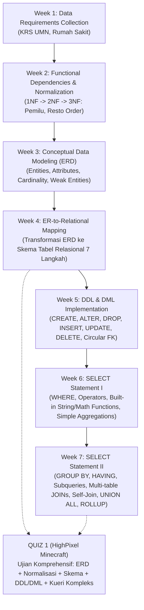
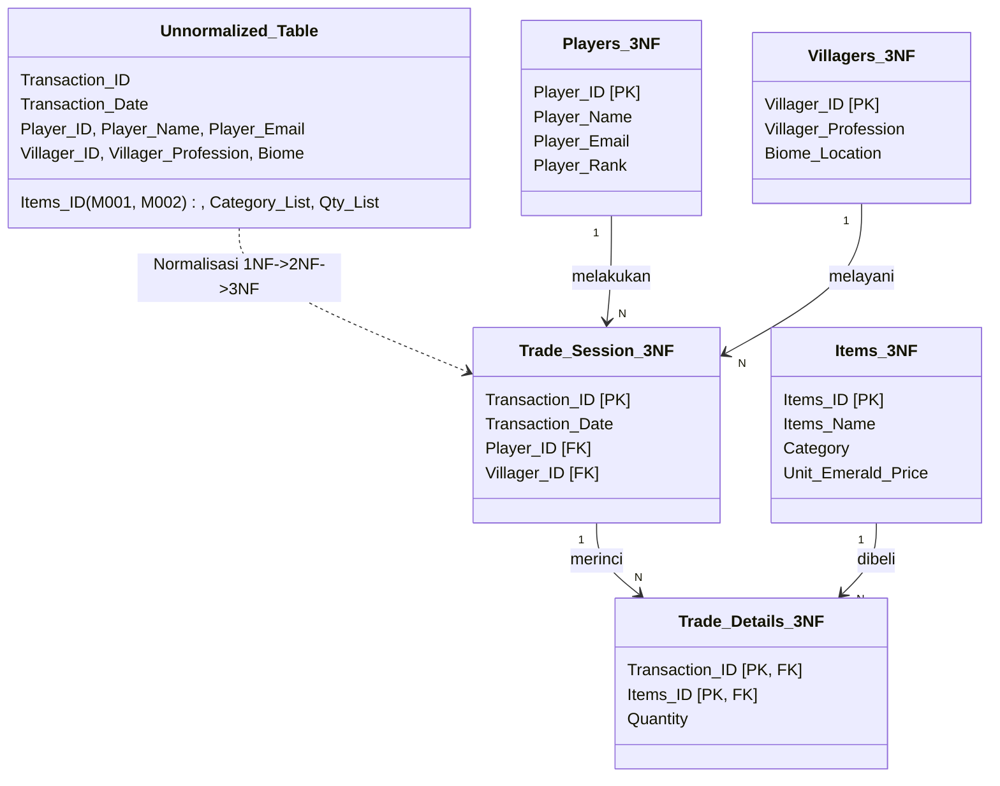

# Rangkuman Komprehensif Sistem Basis Data (IF351) - Persiapan UTS

> [!NOTE]
> Dokumen ini dirancang sebagai panduan belajar lengkap (*all-in-one study guide*) untuk menghadapi Ujian Tengah Semester (UTS) mata kuliah **Sistem Basis Data (IF351)** di Program Studi Informatika, Fakultas Teknik dan Informatika, Universitas Multimedia Nusantara (UMN). Seluruh materi disusun secara bertahap dari konsep dasar hingga kueri tingkat lanjut berdasarkan silabus Week 1 s.d. Week 7, Quiz 1, serta referensi *cheat sheet* resmi.

---

## A. Overview Materi Ujian (Exam Materials Overview)

### 1. Daftar Dokumen Sumber yang Dianalisis
Analisis materi dilakukan terhadap **10 dokumen PDF** yang tersedia di dalam *workspace*:

| No | Nama File Dokumen | Kategori / Sumber | Jumlah Halaman | Status Pembacaan & Ekstraksi |
|:---:|:---|:---|:---:|:---|
| 1 | `IF 351 - Modul Week 1.pdf` | Modul Praktikum UMN | 1 | Berhasil dibaca penuh (Data Requirements Collection) |
| 2 | `IF 351 - Modul Week 2.pdf` | Modul Praktikum UMN | 2 | Berhasil dibaca penuh (Functional Dependency & 1NF-3NF Normalization) |
| 3 | `IF 351 - Modul Week 3.pdf` | Modul Praktikum UMN | 2 | Berhasil dibaca penuh (Conceptual Data Modeling & ERD) |
| 4 | `IF 351 - Modul Week 4.pdf` | Modul Praktikum UMN | 3 | Berhasil dibaca penuh (Relational Database Design: ER-to-Relational Mapping) |
| 5 | `IF 351 - Modul Week 5.pdf` | Modul Praktikum UMN | 5 | Berhasil dibaca penuh (DDL, DML, Constraints, Circular FK, Date Functions) |
| 6 | `IF 351 - Modul Week 6.pdf` | Modul Praktikum UMN | 7 | Berhasil dibaca penuh (SELECT I: Filtering, String & Numeric Functions, Aggregations) |
| 7 | `IF 351 - Modul Week 7.pdf` | Modul Praktikum UMN | 10 | Berhasil dibaca penuh (SELECT II: GROUP BY, HAVING, Subqueries, JOINs, Set Operators, ROLLUP) |
| 8 | `IF351_QUIZ1_CL.pdf` | Naskah Resmi Quiz 1 | 5 | Berhasil dibaca penuh (Kasus Minecraft Trading Server: ERD, 1NF-3NF, Schema, DDL/DML, Advanced SELECT) |
| 9 | `MySQL_Basic_Cheat_Sheet.pdf` | Cheatsheet DataCamp | 1 | Berhasil dibaca penuh (Syntax SELECT, Filtering, Aggregasi, Sintaks MySQL Khusus) |
| 10 | `MySQL_Join_Cheat_Sheet.pdf` | Cheatsheet DataCamp | 1 | Berhasil dibaca penuh (Definisi Relasi & Key, INNER, LEFT, RIGHT, FULL, CROSS, SELF JOIN, Set Operators) |

---

### 2. Peta Topik Pembelajaran (Topic Map Week 1 - Week 7)



---

### 3. Klasifikasi Topik: Berulang (*Recurring*) vs Muncul Sekali (*Single Appearance*)

Berdasarkan perbandingan silabus modul, praktikum mahasiswa, dan naskah Quiz 1, topik pembelajaran dapat dipetakan menjadi:

#### a. Topik Berulang yang Wajib Dikuasai (*Confirmed Recurring Topics - High Exam Priority*)
1. **Normalisasi Database (1NF, 2NF, 3NF):**
   * *Muncul di:* Week 2 (Kasus Pemilu & Kasus Order Restoran), Quiz 1 (Kasus Minecraft Trading HighPixel).
   * *Karakteristik soal:* Diberikan tabel tidak ternormalisasi (*unnormalized table*) berisi nilai jamak (*repeating groups* / *multi-valued*), lalu mahasiswa diminta menguraikan langkah demi langkah menjadi 1NF, 2NF, dan 3NF.
2. **Pemodelan Data ERD & Relational Mapping:**
   * *Muncul di:* Week 3 (5 Kasus Bisnis), Week 4 (5 Kasus Mapping), Quiz 1 (Soal 1 & Soal 4).
   * *Karakteristik soal:* Mengidentifikasi entitas, atribut komposit/multivalue, menentukan relasi ($1:1$, $1:N$, $M:N$), atribut parsial *weak entity*, dan memetakannya menjadi *relational schema* lengkap dengan Primary Key (PK) dan Foreign Key (FK).
3. **Sintaks DDL & DML:**
   * *Muncul di:* Week 5 (Company DB), Week 6 (Restaurant DB), Week 7 (Resto DB & Ikea DB), Quiz 1 (Server Trade DB).
   * *Karakteristik soal:* Penulisan `CREATE TABLE` dengan constraint, `ALTER TABLE` untuk menambah kolom/aturan, serta `INSERT`, `UPDATE`, dan `DELETE`.
4. **Kueri Data Lanjutan (Filtering, String Manipulation, Aggregasi & JOIN):**
   * *Muncul di:* Week 6, Week 7, Quiz 1, dan kedua Cheatsheet.
   * *Karakteristik soal:* Penggunaan `CONCAT()`, `LIKE`, pengelompokan `GROUP BY`, penyaringan grup `HAVING`, penggabungan tabel (`INNER JOIN`, `LEFT JOIN`, `SELF JOIN`), serta subquery skalar.

#### b. Topik Khusus / Muncul Sekali (*Specialized Topics*)
1. **Data Requirements Collection:** Hanya muncul di Week 1 (menentukan entitas dan tipe data sebelum membuat tabel).
2. **Circular Foreign Key Reference & `SET foreign_key_checks`:** Hanya diuji eksplisit di Week 5 (tabel `department` dan `employee` yang saling mereferensikan satu sama lain).
3. **Kalkulasi Selisih Tanggal dengan `TIMESTAMPDIFF()`:** Muncul spesifik di Week 5 soal perhitungan usia karyawan $\ge 50$ tahun.
4. **Logika Hashing & Masking String Berjenjang:** Muncul sebagai studi kasus manipulasi fungsi string kompleks di Week 6 (No 15-16) dan Week 7 (No 17).
5. **Klausul `WITH ROLLUP`:** Muncul spesifik di Week 7 Ikea DB (No 23) untuk menghasilkan baris total keseluruhan (*grand total*).
6. **Set Operator `UNION ALL`:** Muncul di Week 7 Ikea DB (No 24 & No 25) untuk menyatukan baris transaksi toko dan restoran.

---

### 4. Bukti Distribusi Bobot Ujian (*Exam Weight Distribution Evidence*)
Bukti resmi bobot evaluasi tercantum di dalam **Assessment Rubric** naskah `IF351_QUIZ1_CL.pdf`:

| Aspek Penilaian | Bobot | Kriteria Ketuntasan Utama |
|:---|:---:|:---|
| **ERD & Relational Mapping** | **15%** | Entitas, atribut, PK, FK, kardinalitas relasi ($1:1$, $1:N$, $M:N$), dan integritas referensial digambarkan secara presisi. |
| **Normalisasi (1NF, 2NF, 3NF)** | **20%** | Mampu menunjukkan tahapan dekomposisi tabel secara runut dari UNF $
ightarrow$ 1NF $
ightarrow$ 2NF $
ightarrow$ 3NF tanpa kehilangan data (*lossless*). |
| **Database Schema** | **15%** | Skema tabel relasional akhir terdefinisi jelas beserta penetapan kunci PK/FK yang valid. |
| **Implementasi DDL & DML** | **25%** | Sintaks `CREATE TABLE`, `ALTER TABLE`, penentuan tipe data, *constraints*, dan data dummy dieksekusi tanpa *syntax error*. |
| **SELECT Queries** | **25%** | Logika pemanggilan data (JOIN, subquery, kalkulasi agregrat, string/date filtering) berjalan akurat dan menghasilkan dataset yang sesuai. |
| **Total** | **100%** | Nilai Maksimal Quiz / Ujian Praktikum Basis Data |

> [!IMPORTANT]
> Pembagian bobot di atas menegaskan bahwa **50% penilaian berfokus pada perancangan basis data** (ERD, Normalisasi, Skema Relasional), dan **50% berfokus pada penulisan SQL konkret** (DDL, DML, dan kueri SELECT). Mahasiswa harus menguasai kedua aspek ini secara seimbang.

---


## B. Konsep Inti Basis Data (Core Database Concepts)

Materi pada bagian ini mencakup fondasi teoretis basis data relasional yang diujikan dalam Week 1 hingga Week 4 serta naskah Quiz 1.

---

### 1. Model Relasional & Terminologi Dasar (Relational Model Fundamentals)

Dalam sistem basis data modern (RDBMS), data dikelola dalam struktur formal yang disebut **Model Relasional**. Ada padanan antara istilah formal matematika dan istilah praktis industri:

| Istilah Formal (Teori) | Istilah Praktis (SQL / File) | Definisi Sederhana | Analogi Intuitif |
|:---|:---|:---|:---|
| **Relation** | **Table** (Tabel) | Struktur dua dimensi berisikan baris dan kolom yang merepresentasikan entitas dunia nyata. | Sebuah lembar kerja (*sheet*) Excel, misalnya tabel `mahasiswa`. |
| **Tuple** | **Row / Record** (Baris Data) | Satu baris data utuh yang mendeskripsikan satu instansiasi spesifik dari entitas. | Satu kartu identitas/KTP mahasiswa individual. |
| **Attribute** | **Column / Field** (Kolom Data) | Kolom bernama yang menyimpan data dari satu karakteristik tertentu. | Isian pada formulir: Nama, NIM, atau Tanggal Lahir. |
| **Domain** | **Data Type / Set of Values** | Himpunan nilai yang valid dan diizinkan untuk suatu atribut. | Pilihan jenis kelamin (hanya 'L' atau 'P'), atau integer angka semester. |
| **Degree (Arity)** | Jumlah Kolom | Jumlah total atribut/kolom dalam suatu relasi. | Jika tabel memiliki 4 kolom, maka degree-nya adalah 4. |
| **Cardinality** | Jumlah Baris | Jumlah total tupel/baris data yang saat ini ada dalam tabel. | Jika ada 100 mahasiswa terdaftar, cardinalitas tabel adalah 100. |

> [!WARNING]
> **Jebakan Ujian (Exam Trap):** Jangan tertukar antara *Degree* dan *Cardinality*!
> * **Degree** = Jumlah **KOLOM** (bersifat statis sesuai desain struktur tabel).
> * **Cardinality** = Jumlah **BARIS/RECORD** (bersifat dinamis, bertambah saat ada `INSERT` dan berkurang saat `DELETE`).

---

### 2. Kunci Relasional (Relational Keys)

Kunci (*keys*) adalah atribut atau himpunan atribut yang digunakan untuk mengidentifikasi tupel secara unik dan menghubungkan antar tabel.

```
Super Key (Semua kombinasi atribut yang unik)
  └── Candidate Key (Super Key minimal tanpa atribut mubazir)
        ├── Primary Key (Kandidat yang terpilih resmi menjadi identitas utama tabel)
        └── Alternate Key (Kandidat lain yang tidak terpilih menjadi Primary Key)
```

#### a. Super Key
* **Definisi:** Kumpulan satu atau lebih atribut yang secara bersamaan menjamin keunikan setiap baris dalam tabel.
* **Penjelasan Intuitif:** Kumpulan data apa pun yang tidak mungkin kembar.
* **Contoh:** `{nim_mahasiswa}`, `{nim_mahasiswa, nama_mahasiswa}`, `{nim_mahasiswa, email}` semuanya adalah Super Key.

#### b. Candidate Key (Kunci Kandidat)
* **Definisi:** Super Key yang bersifat **minimal** (*irreducible*), artinya jika ada satu atribut saja yang dibuang, ia kehilangan sifat uniknya.
* **Penjelasan Intuitif:** Daftar nama kolom yang sama-sama "pantas" dan siap dicalonkan menjadi Primary Key.
* **Contoh:** Pada tabel Mahasiswa, `{nim_mahasiswa}` unik dan minimal. Kolom `{email}` juga unik dan minimal. Keduanya adalah Candidate Key. Namun `{nim_mahasiswa, nama_mahasiswa}` bukan candidate key karena atribut `nama_mahasiswa` bersifat mubazir/berlebih.

#### c. Primary Key (PK - Kunci Utama)
* **Definisi:** Satu Candidate Key yang dipilih secara resmi oleh perancang database sebagai identitas unik utama tabel.
* **Aturan Mutlak:** **Wajib Unik (UNIQUE)** dan **Tidak Boleh Kosong (NOT NULL)**.
* **Contoh:** `nim_mahasiswa` dipilih sebagai PK tabel Mahasiswa.

#### d. Alternate Key (Secondary Key)
* **Definisi:** Candidate Key yang **tidak terpilih** menjadi Primary Key.
* **Contoh:** Jika `nim_mahasiswa` dipilih sebagai PK, maka `email` menjadi Alternate Key (biasanya diberi constraint `UNIQUE` di SQL).

#### e. Composite Key (Kunci Komposit)
* **Definisi:** Primary Key yang tersusun dari gabungan **dua atribut atau lebih** untuk membentuk nilai identitas yang unik.
* **Kapan Digunakan:** Pada tabel perantara (*junction table*) transaksi $M:N$ atau entitas lemah (*weak entity*).
* **Contoh (Dari Quiz 1 & Modul 6):**
  * Pada tabel `transaction` di Modul 6: `PRIMARY KEY (id_customer, id_paket, id_employee)`
  * Pada tabel detail transaksi Minecraft Quiz 1: `PRIMARY KEY (Transaction_ID, Items_ID)`

#### f. Foreign Key (FK - Kunci Tamu)
* **Definisi:** Atribut pada suatu tabel (tabel anak / *referencing table*) yang nilainya merujuk langsung ke Primary Key pada tabel lain (tabel induk / *referenced table*).
* **Fungsi:** Menjaga hubungan relasi dan menegakkan *Referential Integrity*.
* **Contoh:** Kolom `department_id` di tabel `employee` merujuk ke `department_id` di tabel `department`.

> [!TIP]
> **Surrogate Key vs Natural Key:**
> * **Natural Key:** Kunci unik dari dunia nyata (misal: NIM, Plat Nomor, NIK).
> * **Surrogate Key:** Kunci buatan sistem berupa angka integer berurut (`AUTO_INCREMENT` / ID buatan seperti `id_krs`, `ID_Pemesanan`) yang tidak memiliki arti di dunia nyata namun sangat efisien untuk relasi tabel.

---

### 3. Integritas Data (Data Integrity)

Integritas data adalah aturan (*constraints*) yang menjamin konsistensi, keakuratan, dan kevalidan data di dalam basis data:

1. **Entity Integrity (Integritas Entitas):**
   * *Aturan:* Nilai Primary Key pada setiap tabel harus **selalu unik** dan **tidak boleh bernilai NULL** sama sekali.
   * *Alasan:* Baris data tidak dapat dibedakan atau dicari jika identitas utamanya bernilai kosong/tidak jelas.
2. **Referential Integrity (Integritas Referensial):**
   * *Aturan:* Nilai pada kolom Foreign Key harus berupa salah satu dari dua kondisi:
     1. Nilainya **harus ada** di kolom Primary Key tabel induk yang direferensikan, ATAU
     2. Bernilai **NULL** (jika hubungan bersifat opsional / tidak wajib ada relasi).
   * *Aksi Referential (ON DELETE / ON UPDATE):*
     * `CASCADE`: Jika baris di tabel induk dihapus/diubah, baris anak yang mereferensikannya otomatis ikut terhapus/terupdate.
     * `RESTRICT / NO ACTION`: Menolak penghapusan baris di tabel induk jika masih ada baris anak yang merujuk padanya.
     * `SET NULL`: Mengubah nilai FK di tabel anak menjadi NULL jika induknya dihapus.
3. **Domain Integrity (Integritas Domain):**
   * *Aturan:* Setiap data yang dimasukkan ke suatu kolom harus sesuai dengan tipe data, panjang karakter, format, dan batasan nilai (*CHECK constraint* / *DEFAULT*) yang telah didefinisikan.
   * *Contoh:* Kolom `semester` hanya boleh bernilai integer antara 1 sampai 14; kolom `email` harus berupa string teks.

---

### 4. Jenis Hubungan Antar Tabel (Table Relationships & Cardinalities)

Hubungan antara dua entitas dalam perancangan basis data relasional diklasifikasikan berdasarkan kardinalitas pemetaannya:

```
┌────────────────────────────────────────────────────────┐
│ 1:1  (One-to-One)   : 1 User  <────> 1 Kartu           │
│ 1:N  (One-to-Many)  : 1 Dosen <────< Banyak Mahasiswa │
│ M:N  (Many-to-Many) : M Order <XXXX> N Item            │
│                       (Wajib Junction Table di Fisik!) │
└────────────────────────────────────────────────────────┘
```

1. **One-to-One ($1:1$):**
   * *Definisi:* Satu baris di tabel A hanya boleh berpasangan dengan maksimal satu baris di tabel B, dan sebaliknya.
   * *Contoh (Modul 4 Soal 4 Bioskop):* Setiap Pembeli hanya memiliki 1 Kartu transaksi, dan 1 Kartu hanya dimiliki oleh 1 Pembeli.
   * *Implementasi Relasional:* Tempatkan PK dari tabel Pembeli (`ID_Pembeli`) sebagai FK di tabel Kartu, lalu beri constraint `UNIQUE` pada FK tersebut.
2. **One-to-Many ($1:N$):**
   * *Definisi:* Satu baris di tabel A dapat berhubungan dengan banyak baris di tabel B, tetapi satu baris di tabel B hanya berhubungan dengan satu baris di tabel A.
   * *Contoh (Quiz 1 Minecraft):* Satu Villager Merchant melayani banyak Trade Session, tetapi satu Trade Session ditangani oleh tepat satu Villager Merchant.
   * *Implementasi Relasional:* Tempatkan PK dari sisi "1" (misal `Villager_ID`) sebagai FK di tabel sisi "N" (tabel `Trade_Session`).
3. **Many-to-Many ($M:N$):**
   * *Definisi:* Satu baris di tabel A berhubungan dengan banyak baris di tabel B, dan satu baris di tabel B juga berhubungan dengan banyak baris di tabel A.
   * *Contoh (Quiz 1 Minecraft & Modul 7 Resto):* Satu transaksi dapat membeli banyak jenis Item, dan satu jenis Item dapat dibeli di banyak transaksi berbeda.
   * *Implementasi Relasional:* Hubungan $M:N$ **TIDAK BISA dihubungkan langsung** dengan foreign key biasa! Wajib dibuatkan **Tabel Perantara / Junction Table / Bridge Table** (misal: tabel `Trade_Detail` atau `orderdetails`) yang menyimpan pasangan FK dari kedua tabel induk.

---

### 5. Ketergantungan Fungsional & Normalisasi (Normalization to 3NF)

Normalisasi adalah teknik perancangan basis data secara bertahap untuk **mengurangi redundansi data (duplikasi yang tidak perlu)** dan **mencegah anomali** (*Insertion Anomaly*, *Update Anomaly*, dan *Deletion Anomaly*).

#### a. Ketergantungan Fungsional (Functional Dependency - FD)
Notasi $X 
ightarrow Y$ dibaca: *"X secara fungsional menentukan Y"*, artinya untuk setiap nilai $X$ yang sama, nilai $Y$ pasti selalu sama.
* **Full Functional Dependency:** Atribut $Y$ bergantung sepenuhnya pada keseluruhan atribut kunci $X$, bukan pada sebagian saja.
* **Partial Dependency:** Atribut non-kunci $Y$ hanya bergantung pada **sebagian** atribut dari Primary Key komposit.
* **Transitive Dependency:** Atribut non-kunci $Z$ bergantung pada atribut non-kunci $Y$, sedangkan $Y$ bergantung pada kunci utama $X$ ($X 
ightarrow Y 
ightarrow Z$).

---

#### b. Tahapan Bentuk Normal (1NF, 2NF, 3NF)

##### Bentuk Tidak Normal (UNF - Unnormalized Form)
Tabel berisikan data jamak (*multi-valued attributes*), nilai komposit, atau kelompok berulang (*repeating groups*) yang dipisahkan tanda koma dalam satu sel data.
* *Contoh Nyata dari Naskah Quiz 1:*
  Baris TRX001 memiliki kolom `Items_ID` bernilai `"M001, M002"`, `Category_List` bernilai `"Tool, Material"`, dan `Qty_List` bernilai `"2, 1"`.

##### Bentuk Normal Pertama (1NF - First Normal Form)
* **Syarat:**
  1. Setiap perpotongan baris dan kolom **hanya berisi satu nilai tunggal yang tidak dapat dipecah lagi (Atomic Values)**.
  2. Tidak ada atribut yang berulang (*no repeating groups*).
  3. Telah ditentukan kunci utama (seringkali berupa kunci komposit pada tahap ini).
* **Solusi dari UNF ke 1NF:** Pecah baris yang memiliki nilai ganda menjadi baris-baris terpisah (*flattening the table*). Baris TRX001 dipecah menjadi dua baris: satu untuk item M001 dan satu untuk item M002.
* *Primary Key di 1NF:* Gabungan `(Transaction_ID, Items_ID)`.

##### Bentuk Normal Kedua (2NF - Second Normal Form)
* **Syarat:**
  1. Harus sudah berada dalam bentuk **1NF**.
  2. **TIDAK BOLEH ADA Partial Dependency** (semua atribut non-kunci harus bergantung secara penuh pada seluruh komponen Primary Key).
* **Kapan Perlu Uji 2NF?** Hanya jika Primary Key pada 1NF berupa **Composite Key**! Jika PK hanya 1 kolom tunggal, tabel tersebut otomatis lolos 2NF.
* **Solusi dari 1NF ke 2NF:** Pisahkan atribut yang hanya bergantung pada sebagian kunci menjadi tabel terpisah:
  * Atribut yang hanya bergantung pada `Transaction_ID` (seperti `Transaction_Date`, `Player_ID`, `Villager_ID`) dipisah ke tabel Transaksi.
  * Atribut yang hanya bergantung pada `Items_ID` (seperti `Items_Name`, `Category`, `Unit_Emerald_Price`) dipisah ke tabel Items.
  * Atribut yang bergantung pada gabungan keduanya (`Quantity`) tetap berada di tabel Detail Transaksi bersama composite PK `(Transaction_ID, Items_ID)`.

##### Bentuk Normal Ketiga (3NF - Third Normal Form)
* **Syarat:**
  1. Harus sudah berada dalam bentuk **2NF**.
  2. **TIDAK BOLEH ADA Transitive Dependency** (tidak boleh ada atribut non-kunci yang bergantung pada atribut non-kunci lainnya).
* **Solusi dari 2NF ke 3NF:**
  * Pada tabel Transaksi: `Player_Name` dan `Player_Email` bergantung pada `Player_ID`, bukan langsung pada `Transaction_ID`. Maka data Player dipisahkan ke tabel `Player (Player_ID, Player_Name, Player_Email)`.
  * `Villager_Profession` dan `Biome` bergantung pada `Villager_ID`. Maka data Villager dipisahkan ke tabel `Villager (Villager_ID, Villager_Profession, Biome)`.

---

#### c. Rangkuman Visual Dekomposisi Normalisasi (Kasus Quiz 1 HighPixel Minecraft)



---

### 6. Algoritma Pemetaan ERD ke Skema Relasional (ER-to-Relational Mapping 7 Langkah)

Materi Week 4 berfokus pada 7 langkah baku (*7-Step Mapping Algorithm*) untuk mentransformasikan diagram ER konseptual menjadi tabel-tabel basis data fisik:

| Langkah | Elemen ERD | Aturan Pemetaan ke Skema Relasional | Contoh dari Modul Week 4 |
|:---:|:---|:---|:---|
| **Langkah 1** | **Regular Entity Types (Entitas Kuat)** | Buat satu tabel baru. Masukkan semua atribut tunggal (*simple*). Jika ada atribut komposit (misal `Alamat` terdiri dari jalan, kota, kode pos), pecah menjadi kolom-kolom terpisah. Pilih salah satu key atribut sebagai Primary Key. | Entitas `Film` menjadi tabel `Film (ID_Film [PK], Judul_Film, Durasi, Batas_Umur)`. |
| **Langkah 2** | **Weak Entity Types (Entitas Lemah)** | Buat tabel baru. Masukkan seluruh atribut entitas lemah ditambah Primary Key dari entitas pemilik (*identifying owner entity*) yang bertindak sebagai Foreign Key. Primary Key tabel baru ini adalah **gabungan (Composite PK)** antara FK pemilik + Partial Key entitas lemah. | Entitas `Keluarga` operator bus (Modul 4 No 5) dipetakan menjadi `Keluarga_Operator (ID_Operator [FK], Nama_Anggota, Hubungan, Tanggal_Lahir)` dengan PK `(ID_Operator, Nama_Anggota)`. |
| **Langkah 3** | **Binary 1:1 Relationship** | Pilih salah satu entitas (disarankan entitas yang memiliki partisipasi total/*mandatory*), lalu masukkan Primary Key entitas pasangannya sebagai **Foreign Key**. Beri constraint `UNIQUE` pada kolom FK tersebut. | Relasi antara `Pembeli` dan `Kartu`: tabel `Kartu (Kode_Kartu [PK], Saldo, ID_Pembeli [FK UNIQUE])`. |
| **Langkah 4** | **Binary 1:N Relationship** | Selalu tempatkan Primary Key dari sisi "1" (*parent side*) ke dalam tabel sisi "N" (*child side*) sebagai **Foreign Key**. | Relasi `Minimarket` (1) ke `Karyawan` (N): tabel `Karyawan` menampung FK `Kode_Minimarket`. |
| **Langkah 5** | **Binary M:N Relationship** | Buat tabel relasi baru (*junction table*). Masukkan Primary Key dari kedua entitas sebagai Foreign Key. Gabungan kedua FK tersebut membentuk **Composite Primary Key**. Sertakan juga atribut relasi jika ada (misal `tanggal_transaksi`, `jumlah`). | Relasi `Film` ke `Genre` (Modul 4 No 4): tabel `Film_Genre (ID_Film [FK], ID_Genre [FK])` dengan PK `(ID_Film, ID_Genre)`. |
| **Langkah 6** | **Multivalued Attributes (Atribut Bernilai Banyak)** | Buat tabel baru untuk atribut bernilai banyak tersebut. Masukkan atribut tersebut bersama Primary Key dari entitas induk sebagai Foreign Key. PK tabel baru adalah gabungan FK induk + atribut tersebut. | Pekerja yang memiliki lebih dari satu nomor HP: tabel `Pekerja_NoHP (ID_Pekerja [FK], Nomor_HP)` dengan PK `(ID_Pekerja, Nomor_HP)`. |
| **Langkah 7** | **N-ary Relationship ($n > 2$)** | Buat tabel baru. Masukkan Primary Key dari semua entitas yang terlibat ($n$ buah) sebagai Foreign Key. Sertakan atribut relasi jika ada. | Relasi ternari antara Pembeli, Jadwal, dan Tiket. |

---


## C. Fondasi SQL & Pola Kueri (SQL Fundamentals & Query Patterns)

Bagian ini menguraikan seluruh sintaks SQL yang dipelajari pada Week 5, Week 6, Week 7, Quiz 1, dan kedua Cheatsheet DataCamp. Setiap konsep dilengkapi 7 elemen evaluasi standar.

---

### 1. `SELECT`, `FROM`, dan `WHERE`

* **Fungsi:** Mengambil data spesifik dari satu atau lebih tabel dan menyaring baris berdasarkan kondisi logika tertentu.
* **Kapan Digunakan:** Pada hampir setiap operasi pembacaan data di database.
* **Sintaks:**
  ```sql
  SELECT kolom1, kolom2 
  FROM nama_tabel 
  WHERE kondisi_logika;
  ```
* **Contoh Kode:**
  ```sql
  SELECT nama_depan, jabatan, gaji 
  FROM employee 
  WHERE jabatan = 'Cashier';
  ```
* **Penjelasan Hasil:** Menampilkan 3 kolom (`nama_depan`, `jabatan`, `gaji`) hanya untuk karyawan yang nilai kolom `jabatan`-nya persis sama dengan `'Cashier'`. Baris dengan jabatan 'Manager' atau 'Chef' diabaikan.
* **Kesalahan Umum & Solusi:** Lupa tanda petik satu `'...'` pada data bertipe string atau teks. Contoh salah: `WHERE jabatan = Cashier;` (akan memunculkan error: `Unknown column 'Cashier' in 'where clause'`). Solusi: Selalu bungkus nilai string/tanggal dengan petik tunggal.
* **Ciri-ciri di Soal Ujian:** Kata kunci: *"Tampilkan data X yang memiliki kondisi Y..."*, *"Hanya tampilkan karyawan yang bekerja sebagai..."*.

---

### 2. `DISTINCT`

* **Fungsi:** Menghilangkan baris duplikat dari hasil kueri, sehingga hanya nilai-nilai unik yang ditampilkan.
* **Kapan Digunakan:** Ketika suatu kolom memiliki banyak data berulang dan Anda hanya ingin mengetahui daftar nilai yang unik/berbeda.
* **Sintaks:**
  ```sql
  SELECT DISTINCT kolom1 FROM nama_tabel;
  ```
* **Contoh Kode (Dari Modul 7 No 12):**
  ```sql
  SELECT DISTINCT CONCAT(e.nama_depan, ' ', e.nama_belakang) AS Nama
  FROM employee e
  JOIN `transaction` t ON e.id_employee = t.id_employee;
  ```
* **Penjelasan Hasil:** Jika seorang karyawan telah melayani 50 transaksi, namanya biasanya akan muncul 50 kali pada hasil JOIN. Penambahan `DISTINCT` memastikan namanya hanya dicetak 1 kali saja.
* **Kesalahan Umum & Solusi:** Menempatkan `DISTINCT` di tengah daftar kolom, misal: `SELECT nama_depan, DISTINCT jabatan FROM employee;` (Syntax Error). Solusi: `DISTINCT` harus diletakkan persis tepat setelah kata `SELECT` dan berlaku untuk seluruh kombinasi kolom yang dipilih.
* **Ciri-ciri di Soal Ujian:** Kata kunci: *"Tampilkan daftar unik..."*, *"Tampilkan karyawan yang pernah bertransaksi tanpa pengulangan nama"*.

---

### 3. `ORDER BY`, `ASC`, dan `DESC`

* **Fungsi:** Mengurutkan baris data hasil kueri berdasarkan satu atau lebih kolom, baik secara menaik (*Ascending* / A-Z / 1-9) maupun menurun (*Descending* / Z-A / 9-1).
* **Kapan Digunakan:** Saat pengguna meminta data disajikan secara terurut (misal dari yang termahal, terlama, atau alfabetis nama).
* **Sintaks:**
  ```sql
  SELECT kolom1, kolom2 
  FROM nama_tabel 
  ORDER BY kolom1 ASC, kolom2 DESC;
  ```
* **Contoh Kode (Dari Quiz 1 Soal 8):**
  ```sql
  SELECT Transaction_ID, Transaction_Date 
  FROM Trade_Session 
  ORDER BY Transaction_Date DESC;
  ```
* **Penjelasan Hasil:** Transaksi dengan tanggal paling baru (*terkini*) akan ditampilkan di baris paling atas, diikuti transaksi yang lebih lama ke bawah.
* **Kesalahan Umum & Solusi:** Mengira bahwa default pengurutan adalah `DESC`. Faktanya jika arah urutan tidak ditulis, SQL otomatis menggunakan `ASC`.
* **Ciri-ciri di Soal Ujian:** Kata kunci: *"Urutkan berdasarkan..."*, *"Dari yang tertinggi ke terendah"*, *"Transaksi paling baru"* (`ORDER BY date DESC`).

---

### 4. Operator Pembanding, Logika, dan Pattern Matching (`LIKE`, `BINARY`)

* **Fungsi:** Membangun kriteria penyaringan data kompleks pada klausul `WHERE`.
  * Operator Pembanding: `=`, `<>`, `!=`, `<`, `<=`, `>`, `>=`
  * Operator Logika: `AND`, `OR`, `NOT`, `BETWEEN ... AND ...`, `IN (...)`
  * Pattern Matching: `LIKE '%pola%'`
* **Wildcards pada `LIKE`:**
  * `%` : Mewakili nol, satu, atau banyak karakter sembarang.
  * `_` : Mewakili tepat satu karakter sembarang.
* **Kapan Digunakan:** Mencari teks berdasarkan awalan/akhiran/domain email, atau membatasi rentang nilai angka.
* **Contoh Kode (Dari Modul 6 No 11 & Cheatsheet):**
  ```sql
  -- Mencari email yahoo
  SELECT nama_depan, email 
  FROM employee 
  WHERE email LIKE '%@yahoo.com';

  -- Pencocokan Case-Sensitive khusus MySQL
  SELECT * FROM franchises WHERE BINARY owner = 'The Walt Disney Company';
  ```
* **Penjelasan Hasil:** `%@yahoo.com` mencocokkan string apa pun asalkan diakhiri dengan `@yahoo.com`. Operator `BINARY` memaksa MySQL membedakan huruf besar dan kecil (case-sensitive).
* **Kesalahan Umum & Solusi:** Menggunakan operator `=` saat ingin mencocokkan wildcard. Contoh salah: `WHERE email = '%@yahoo.com'` (akan mencari email yang secara harfiah bertuliskan `"%@yahoo.com"` dan tidak menemukan apa pun).
* **Ciri-ciri di Soal Ujian:** Kata kunci: *"Yang memiliki domain email gmail"*, *"Huruf depan berawalan 'A'"*, *"Gaji berada di antara 3 juta dan 5 juta"*.

---

### 5. `GROUP BY`

* **Fungsi:** Mengelompokkan baris-baris data yang memiliki nilai yang sama pada satu atau beberapa kolom ke dalam baris ringkasan (*summary rows*).
* **Kapan Digunakan:** Setiap kali Anda menggunakan fungsi agregasi (`COUNT`, `SUM`, `AVG`, `MIN`, `MAX`) dan ingin menghitung nilai agregat tersebut **per kategori / per entitas**.
* **Sintaks:**
  ```sql
  SELECT kolom_kategori, AGG_FUNCTION(kolom_nilai)
  FROM nama_tabel
  GROUP BY kolom_kategori;
  ```
* **Contoh Kode (Dari Modul 7 No 8):**
  ```sql
  SELECT MONTHNAME(transaction_date) AS Bulan, COUNT(*) AS Jumlah_Transaksi
  FROM `transaction`
  GROUP BY MONTH(transaction_date);
  ```
* **Penjelasan Hasil:** Baris-baris transaksi akan disatukan berdasarkan bulannya, lalu fungsi `COUNT(*)` menghitung berapa kali transaksi terjadi pada setiap kelompok bulan tersebut.
* **Kesalahan Umum & Solusi:** Memilih kolom biasa di bagian `SELECT` yang **tidak masuk** ke dalam daftar `GROUP BY` dan **bukan** bagian dari fungsi agregasi. Pada MySQL mode ketat (`ONLY_FULL_GROUP_BY`), ini akan menghasilkan error fatal `Error 1055`.
* **Ciri-ciri di Soal Ujian:** Kata kunci: *"Jumlah transaksi tiap bulan"*, *"Total pengeluaran per pelanggan"*, *"Banyaknya karyawan pada setiap departemen"*.

---

### 6. Fungsi Agregasi: `COUNT()`, `SUM()`, `AVG()`, `MIN()`, `MAX()`

* **Fungsi:** Melakukan kalkulasi matematis terhadap sekumpulan baris data dalam satu kolom dan mengembalikan **satu nilai tunggal**.
  * `COUNT(*)`: Menghitung total jumlah baris data (termasuk baris bernilai NULL).
  * `COUNT(kolom)`: Menghitung jumlah baris yang nilainya **TIDAK NULL** pada kolom tersebut.
  * `COUNT(DISTINCT kolom)`: Menghitung jumlah nilai unik yang tidak duplikat.
  * `SUM(kolom)`: Menjumlahkan seluruh angka pada kolom numerik.
  * `AVG(kolom)`: Menghitung rata-rata nilai numerik (mengabaikan nilai NULL).
  * `MIN(kolom)` / `MAX(kolom)`: Mencari nilai terendah / tertinggi.
* **Contoh Kode:**
  ```sql
  SELECT 
      COUNT(*) AS Total_Karyawan,
      SUM(gaji) AS Total_Beban_Gaji,
      AVG(gaji) AS Rata_Gaji,
      MIN(gaji) AS Gaji_Terendah,
      MAX(gaji) AS Gaji_Tertinggi
  FROM employee;
  ```
* **Kesalahan Umum & Solusi:** Menggunakan `SUM()` saat soal meminta nilai terbesar/tertinggi (`MAX()`), atau menggunakan `COUNT(kolom)` dengan asumsi menghitung semua baris padahal ada sel yang bernilai NULL.
* **Ciri-ciri di Soal Ujian:** Kata kunci: *"Total gaji"*, *"Rata-rata harga"*, *"Barang dengan stok terbanyak"*, *"Berapa banyak transaksi"*.

---

### 7. `HAVING` versus `WHERE`

* **Fungsi:** 
  * `WHERE`: Menyaring baris data **SEBELUM** proses pengelompokan (*GROUP BY*) dilakukan. `WHERE` bekerja pada level baris individual dan **TIDAK BISA** menerima fungsi agregasi.
  * `HAVING`: Menyaring kelompok data **SETELAH** proses pengelompokan (*GROUP BY*) dan perhitungan agregasi selesai dilakukan.
* **Sintaks:**
  ```sql
  SELECT kolom_kategori, SUM(nilai)
  FROM nama_tabel
  WHERE kondisi_baris_individual
  GROUP BY kolom_kategori
  HAVING SUM(nilai) > ambang_batas;
  ```
* **Contoh Kode (Dari Quiz 1 Soal 11):**
  ```sql
  SELECT v.Villager_ID, v.Villager_Profession, SUM(td.Quantity * i.Unit_Emerald_Price) AS Total_Emeralds
  FROM Villagers v
  JOIN Trade_Session ts ON v.Villager_ID = ts.Villager_ID
  JOIN Trade_Details td ON ts.Transaction_ID = td.Transaction_ID
  JOIN Items i ON td.Items_ID = i.Items_ID
  GROUP BY v.Villager_ID, v.Villager_Profession
  HAVING Total_Emeralds > 20;
  ```
* **Penjelasan Hasil:** Menghitung total emerald per villager. Filter `HAVING Total_Emeralds > 20` hanya meloloskan kelompok villager yang omset totalnya melebihi 20 emerald.
* **Kesalahan Umum & Solusi:** Menulis filter agregasi di dalam `WHERE`, misalnya: `WHERE SUM(td.Quantity * i.Unit_Emerald_Price) > 20` $
ightarrow$ **ERROR 1111: Invalid use of group function**. Solusi: Pindahkan kondisi agregat tersebut ke klausul `HAVING`.
* **Ciri-ciri di Soal Ujian:** Kata kunci: *"Hanya tampilkan kelompok yang total/rata-ratanya melebihi..."*, *"Pekerja yang mengurus transaksi minimal 2 transaksi"*.

---

### 8. Multi-table `JOIN` (`INNER`, `LEFT`, `RIGHT`, `FULL`, `CROSS`)

* **Fungsi:** Menggabungkan baris data dari dua tabel atau lebih secara horizontal berdasarkan kolom keterhubungan (*Foreign Key = Primary Key*).

```
INNER JOIN : Hanya baris yang berpasangan di KEDUA tabel (Irisan).
LEFT JOIN  : SEMUA baris tabel KIRI + baris tabel Kanan yang cocok (jika tidak cocok, NULL).
RIGHT JOIN : SEMUA baris tabel KANAN + baris tabel Kiri yang cocok.
FULL JOIN  : SEMUA baris dari KEDUA tabel (didukung lewat UNION di MySQL).
CROSS JOIN : Perkalian Cartesian (setiap baris A dipasangkan ke semua baris B).
```

* **Contoh Sintaks & Kode:**
  ```sql
  -- INNER JOIN
  SELECT e.nama_depan, d.department_name
  FROM employee e
  INNER JOIN department d ON e.department_id = d.department_id;

  -- LEFT JOIN (Menampilkan karyawan yang belum punya departemen sekalipun)
  SELECT e.nama_depan, d.department_name
  FROM employee e
  LEFT JOIN department d ON e.department_id = d.department_id;
  ```
* **Kesalahan Umum & Solusi:** Lupa menentukan klausul penghubung `ON e.fk = d.pk`. Jika lupa `ON`, kueri akan menghasilkan *Cartesian Product* (*Cross Join*) yang melipatgandakan jumlah baris secara masif dan salah!
* **Ciri-ciri di Soal Ujian:** Kata kunci: *"Tampilkan nama mahasiswa beserta nama mata kuliah yang diambil"*, *"Tampilkan semua pelanggan dan transaksi mereka jika ada"*.

---

### 9. Self-Join dan Table Aliases

* **Fungsi:** Menggabungkan suatu tabel **dengan dirinya sendiri**. Digunakan ketika suatu baris dalam tabel memiliki relasi ke baris lain dalam tabel yang sama (relasi rekursif/hierarkis).
* **Kapan Digunakan:** Menampilkan struktur organisasi (karyawan dan managernya), perbandingan antar baris dalam satu tabel.
* **Sintaks:**
  ```sql
  SELECT e.kolom AS Karyawan, m.kolom AS Manager
  FROM nama_tabel e
  JOIN nama_tabel m ON e.manager_id = m.id;
  ```
* **Contoh Kode (Dari Modul 7 No 26 Ikea DB):**
  ```sql
  SELECT 
      CONCAT(m.FirstName, ' ', m.LastName) AS Manager,
      GROUP_CONCAT(CONCAT(e.FirstName, ' ', e.LastName)) AS Employees
  FROM employees e
  JOIN employees m ON e.ManagerID = m.EmployeeID
  GROUP BY m.EmployeeID;
  ```
* **Penjelasan Hasil:** Tabel `employees` dipanggil dua kali dengan alias berbeda: `e` mewakili bawahan, dan `m` mewakili atasan. Baris dihubungkan saat `e.ManagerID = m.EmployeeID`.
* **Kesalahan Umum & Solusi:** Tidak menggunakan alias tabel sehingga nama kolom menjadi ambigu. Contoh salah: `SELECT FirstName FROM employees JOIN employees ON ManagerID = EmployeeID;` $
ightarrow$ **ERROR 1052: Column 'FirstName' in field list is ambiguous**.
* **Ciri-ciri di Soal Ujian:** Kata kunci: *"Tampilkan nama karyawan beserta nama atasannya / managernya"*.

---

### 10. `UNION` versus `UNION ALL`

* **Fungsi:** Menggabungkan hasil dari dua perintah `SELECT` atau lebih secara vertikal menjadi satu dataset.
* **Perbedaan Utama:**
  * `UNION`: Menghapus baris duplikat yang sama persis (melakukan deduplikasi otomatis, proses sorting lebih lambat).
  * `UNION ALL`: Mempertahankan seluruh baris termasuk baris duplikat (lebih cepat dieksekusi).
* **Syarat Mutlak:**
  1. Jumlah kolom pada setiap kueri `SELECT` **harus sama persis**.
  2. Urutan tipe data kolom yang bersesuaian harus kompatibel.
* **Contoh Kode (Dari Modul 7 No 24 Ikea DB):**
  ```sql
  SELECT EmployeeID FROM orders
  UNION ALL
  SELECT EmployeeID FROM restaurant;
  ```
* **Kesalahan Umum & Solusi:** Menggabungkan dua kueri dengan jumlah kolom yang berbeda. Misal kueri 1 memilih 3 kolom, sedangkan kueri 2 memilih 2 kolom $
ightarrow$ **ERROR 1222: The used SELECT statements have a different number of columns**.
* **Ciri-ciri di Soal Ujian:** Kata kunci: *"Gabungkan riwayat transaksi dari divisi toko fisik dan divisi online"*, *"Gabungkan seluruh pesanan barang dan pesanan restoran"*.

---

### 11. Subqueries (Kueri di dalam Kueri)

* **Fungsi:** Kueri pembantu bersarang (*nested query*) yang berada di dalam kueri utama untuk menghasilkan nilai sementara.
* **Jenis-Jenis Subquery:**
  1. **Scalar Subquery:** Mengembalikan tepat **satu baris dan satu kolom** (satu nilai tunggal). Dapat digunakan di `WHERE`, `SELECT`, atau `HAVING`.
  2. **Multi-Row Subquery:** Mengembalikan daftar satu kolom dengan banyak baris. Menggunakan operator `IN`, `NOT IN`, `ANY`, atau `ALL`.
  3. **Derived Table (Subquery di dalam FROM):** Mengembalikan tabel sementara yang wajib diberi alias.
* **Contoh Kode (Dari Modul 7 No 9 & Quiz 1 Soal 12):**
  ```sql
  -- Mencari karyawan bergaji terendah di domain gmail
  SELECT CONCAT(nama_depan, ' ', nama_belakang) AS Nama, gaji
  FROM employee 
  WHERE email LIKE '%@gmail.com'
    AND gaji = (SELECT MIN(gaji) FROM employee WHERE email LIKE '%@gmail.com');

  -- Item dengan harga di atas rata-rata (Quiz 1 No 12)
  SELECT Item_Name, Unit_Emerald_Price
  FROM Items
  WHERE Unit_Emerald_Price > (SELECT AVG(Unit_Emerald_Price) FROM Items);
  ```
* **Kesalahan Umum & Solusi:** Menggunakan operator perbandingan skalar (`=`) terhadap subquery yang menghasilkan banyak baris. Contoh salah: `WHERE gaji = (SELECT gaji FROM employee)` $
ightarrow$ **ERROR 1242: Subquery returns more than 1 row**. Solusi: Gunakan operator `IN (...)` jika subquery berpotensi mengembalikan banyak baris.
* **Ciri-ciri di Soal Ujian:** Kata kunci: *"Yang memiliki nilai di atas rata-rata"*, *"Karyawan dengan gaji paling rendah di divisinya"*.

---

### 12. `CONCAT()` versus `GROUP_CONCAT()`

* **Fungsi:**
  * `CONCAT(str1, str2, ...)`: Menggabungkan beberapa string **secara horizontal dalam 1 baris record yang sama**.
  * `GROUP_CONCAT(kolom)`: Menggabungkan nilai string dari **banyak baris record yang berbeda secara vertikal menjadi satu teks koma terpisah** pada suatu kelompok `GROUP BY`.
* **Contoh Kode:**
  ```sql
  -- CONCAT horizontal
  SELECT CONCAT(nama_depan, ' ', nama_belakang) AS Nama_Lengkap FROM employee;

  -- GROUP_CONCAT vertikal (Daftar pelanggan yang dilayani tiap karyawan)
  SELECT e.nama_depan, GROUP_CONCAT(c.nama_depan ORDER BY c.nama_depan ASC SEPARATOR ', ') AS Daftar_Pelanggan
  FROM employee e
  JOIN `transaction` t ON e.id_employee = t.id_employee
  JOIN customer c ON t.id_customer = c.id_customer
  GROUP BY e.id_employee;
  ```
* **Kesalahan Umum & Solusi:** Menggunakan `CONCAT()` dengan harapan menyatukan daftar nama dari banyak transaksi (hanya menghasilkan gabungan string baris per baris). Gunakan `GROUP_CONCAT()` untuk mengumpulkan deretan baris menjadi 1 sel teks berangkai.
* **Ciri-ciri di Soal Ujian:** Kata kunci: *"Gabungkan nama depan dan nama belakang"* (`CONCAT`), *"Tampilkan daftar jadwal transaksi / daftar nama pelanggan yang dilayani dalam satu baris"* (`GROUP_CONCAT`).

---

### 13. `NULL`, `IS NULL`, dan `IS NOT NULL`

* **Fungsi:** Mengecek keberadaan data yang kosong / tidak memiliki nilai (*unknown / missing value*).
* **Aturan Logika Three-Valued Logic (3VL):**
  * Nilai `NULL` bukan berarti angka `0`, dan bukan teks kosong `''`. `NULL` adalah ketiadaan nilai (*unknown*).
  * Operasi pembandingan seperti `kolom = NULL` atau `kolom != NULL` akan selalu menghasilkan `UNKNOWN` (False).
* **Sintaks yang Benar:**
  ```sql
  SELECT * FROM employee WHERE nama_belakang IS NULL;
  SELECT * FROM employee WHERE manager_id IS NOT NULL;
  ```
* **Kesalahan Umum & Solusi:** Menulis `WHERE nama_belakang = NULL` atau `WHERE manager_id != NULL`. Kueri tidak akan mengembalikan baris apa pun tanpa error. Solusi: Wajib gunakan sintaks `IS NULL` dan `IS NOT NULL`.
* **Ciri-ciri di Soal Ujian:** Kata kunci: *"Karyawan yang tidak memiliki atasan"*, *"Hanya tampilkan karyawan yang memiliki nama belakang"*.

---

### 14. `LIMIT` (dan `LIMIT offset, count`)

* **Fungsi:** Membatasi jumlah baris record yang dikembalikan oleh kueri ke layar.
* **Sintaks:**
  * `LIMIT n`: Mengambil $n$ baris pertama.
  * `LIMIT offset, n`: Melewati sebanyak $offset$ baris dari atas, lalu mengambil $n$ baris berikutnya.
* **Contoh Kode (Dari Modul 7 No 14 & Cheatsheet):**
  ```sql
  -- Customer dengan nama terpanjang (hanya peringkat 1)
  SELECT CONCAT(nama_depan, ' ', nama_belakang) AS Nama
  FROM customer
  ORDER BY CHARACTER_LENGTH(Nama) DESC
  LIMIT 1;

  -- Mengambil 3 baris setelah melewati 2 baris teratas (halaman berikutnya)
  SELECT * FROM franchises LIMIT 2, 3;
  ```
* **Kesalahan Umum & Solusi:** Meletakkan klausul `LIMIT` sebelum `ORDER BY`. Urutan penulisan SQL baku mewajibkan `LIMIT` ditaruh di **posisi paling akhir** dari seluruh struktur kueri.
* **Ciri-ciri di Soal Ujian:** Kata kunci: *"Tampilkan 3 rak teratas..."*, *"Hanya ambil 1 data peringkat pertama..."*.

---

### 15. Fungsi Manipulasi String Lengkap (Week 6 & Week 7)

Kumpulan fungsi manipulasi teks yang wajib dihafal untuk ujian praktikum:

| Fungsi SQL | Deskripsi Singkat | Contoh Pemakaian | Hasil Contoh |
|:---|:---|:---|:---|
| `LEFT(str, len)` | Ambil $len$ huruf dari paling kiri | `LEFT('Hansen', 4)` | `'Hans'` |
| `RIGHT(str, len)` | Ambil $len$ huruf dari paling kanan | `RIGHT('Hansen', 4)` | `'nsen'` |
| `SUBSTRING(str, pos, len)` / `MID()` | Ambil substring mulai posisi $pos$ sepanjang $len$ (indeks 1-based) | `SUBSTRING('Hansen', 2, 3)` | `'ans'` |
| `SUBSTRING_INDEX(str, delim, count)` | Ambil teks sebelum kemunculan ke-$count$ dari karakter pembatas $delim$ | `SUBSTRING_INDEX('275 Love Annex', ' ', 2)` | `'275 Love'` |
| `LOWER(str)` / `UPPER(str)` | Konversi teks ke huruf kecil / huruf besar | `UPPER('techno')` | `'TECHNO'` |
| `REVERSE(str)` | Membalik susunan urutan karakter teks | `REVERSE('Hansen')` | `'nesnaH'` |
| `TRIM(str)` | Menghapus spasi di awal (*leading*) dan akhir (*trailing*) | `TRIM('  abc  ')` | `'abc'` |
| `LPAD(str, len, pad)` | Mengisi karakter $pad$ di sebelah kiri hingga mencapai panjang $len$ | `LPAD('hi', 5, 'b')` | `'bbbhi'` |
| `REPEAT(str, count)` | Mengulang pencetakan teks sebanyak $count$ kali | `REPEAT('$', 4)` | `'$$$$'` |
| `LOCATE(substr, str, [pos])` | Menemukan posisi kemunculan pertama karakter di dalam string | `LOCATE('n', 'Hansen', 1)` | `3` |
| `CHARACTER_LENGTH(str)` | Menghitung jumlah total karakter dalam teks | `CHARACTER_LENGTH('Budi')` | `4` |

---

### 16. Fungsi Numerik & Tanggal (Week 5 & Week 6)

| Fungsi SQL | Deskripsi Singkat | Contoh Pemakaian & Hasil |
|:---|:---|:---|
| `TRUNCATE(angka, desimal)` | Memotong angka tanpa pembulatan | `TRUNCATE(20.599, 1)` $
ightarrow$ `20.5` |
| `DIV` & `MOD` (%) | Pembagian bulat (*integer division*) dan sisa bagi (*modulo*) | `1000000 DIV 200000` $
ightarrow$ `5`; `10 MOD 3` $
ightarrow$ `1` |
| `CURDATE()` / `NOW()` | Mendapatkan tanggal hari ini / waktu timestamp saat ini | `SELECT CURDATE(), NOW();` |
| `DATE_FORMAT(date, format)` | Memformat tampilan tanggal ke bentuk teks bebas | `DATE_FORMAT('2026-03-24', '%d %M %Y')` $
ightarrow$ `'24 March 2026'` |
| `YEAR()`, `MONTH()`, `DAY()` | Mengambil angka tahun, angka bulan (1-12), atau hari (1-31) | `MONTH('2026-11-20')` $
ightarrow$ `11` |
| `MONTHNAME(date)` | Mengambil nama bulan bahasa Inggris | `MONTHNAME('2026-03-01')` $
ightarrow$ `'March'` |
| `TIMESTAMPDIFF(unit, tgl1, tgl2)` | Menghitung selisih umur/waktu antara dua tanggal | `TIMESTAMPDIFF(YEAR, '1970-01-01', '2026-01-01')` $
ightarrow$ `56` |

---

### 17. Ekspresi Kondisional: `CASE WHEN` dan `IF()`

* **Fungsi:** Mengimplementasikan logika percabangan (*if-else*) langsung di dalam kueri SQL.
* **Sintaks:**
  ```sql
  CASE 
      WHEN kondisi1 THEN hasil1
      WHEN kondisi2 THEN hasil2
      ELSE hasil_default
  END AS nama_alias
  ```
* **Contoh Kode (Dari Modul 7 No 13):**
  ```sql
  SELECT transaction_date,
      CASE 
          WHEN transaction_date < '2016-05-01' THEN 'Transaksi Lama'
          WHEN transaction_date >= '2016-05-01' THEN 'Transaksi Baru'
          ELSE 'Tidak Diketahui'
      END AS Kategori_Waktu
  FROM `transaction`;
  ```

---

### 18. Klausul `WITH ROLLUP` (Grand Total Baris Terakhir)

* **Fungsi:** Ekstensi dari `GROUP BY` di MySQL yang secara otomatis menambahkan **baris ringkasan tingkat lebih tinggi (*subtotal* dan *grand total*)** di bagian paling bawah tabel hasil kueri.
* **Contoh Kode (Dari Modul 7 No 23 Ikea DB):**
  ```sql
  SELECT 
      IFNULL(r.f_orderid, 'TOTAL KESELURUHAN') AS Order_ID,
      SUM(f.price) AS Total_Pendapatan
  FROM restaurant r
  JOIN forderdetails f ON r.f_orderid = f.f_orderid
  WHERE r.f_orderdate >= '2015-01-01' AND r.f_orderdate < '2015-02-01'
  GROUP BY r.f_orderid WITH ROLLUP;
  ```
* **Penjelasan Hasil:** Menampilkan subtotal untuk setiap `f_orderid`. Pada baris paling akhir, kolom `Order_ID` akan bernilai `NULL` (yang diubah menjadi `'TOTAL KESELURUHAN'` via `IFNULL`), dan kolom `Total_Pendapatan` menampilkan penjumlahan total dari seluruh order yang ada.

---

### 19. Sintaks DDL & DML Lengkap (Week 5 & Quiz 1)

#### a. Data Definition Language (DDL) - Mengelola Struktur
```sql
-- 1. Membuat Database
CREATE DATABASE IF NOT EXISTS db_krs;
USE db_krs;

-- 2. Membuat Tabel dengan Berbagai Constraint
CREATE TABLE IF NOT EXISTS Mahasiswa (
    nim_mahasiswa CHAR(6) NOT NULL,
    nama_mahasiswa VARCHAR(50) NOT NULL,
    program_studi VARCHAR(50) NOT NULL,
    semester INT NOT NULL,
    email VARCHAR(100) UNIQUE,
    CONSTRAINT pk_mahasiswa PRIMARY KEY (nim_mahasiswa),
    CONSTRAINT chk_semester CHECK (semester >= 1 AND semester <= 14)
);

-- 3. Mengubah Struktur Tabel (ALTER TABLE)
-- Menambah kolom baru
ALTER TABLE Mahasiswa ADD alamat VARCHAR(255) DEFAULT 'Tangerang';

-- Menambah Foreign Key relasi sirkular (Modul Week 5)
ALTER TABLE department ADD CONSTRAINT fk_manager 
FOREIGN KEY (manager_id) REFERENCES employee(employee_id);

-- 4. Menghapus Tabel & Database dengan Aman
SET foreign_key_checks = 0; -- Matikan sementara pengecekan FK jika ada sirkular
DROP TABLE IF EXISTS department;
DROP TABLE IF EXISTS employee;
SET foreign_key_checks = 1; -- Nyalakan kembali
DROP DATABASE IF EXISTS db_krs;
```

#### b. Data Manipulation Language (DML) - Mengelola Isi Data
```sql
-- 1. Memasukkan Data (INSERT)
INSERT INTO Mahasiswa (nim_mahasiswa, nama_mahasiswa, program_studi, semester)
VALUES ('163633', 'Raditya Indra', 'Informatika', 3);

-- 2. Memperbarui Data (UPDATE) - Jangan lupa WHERE!
UPDATE Mahasiswa
SET semester = semester + 1,
    program_studi = 'Informatika Peminatan Data'
WHERE nim_mahasiswa = '163633';

-- 3. Menghapus Baris Data (DELETE)
DELETE FROM Mahasiswa
WHERE nim_mahasiswa = '163633';
```

---


## D. Perbedaan Penting Konsep SQL (Important SQL Differences)

Bagian ini membedah konsep-konsep SQL yang sering kali membingungkan atau menjadi sumber jebakan dalam ujian teori maupun praktikum.

---

### 1. `WHERE` versus `HAVING`

| Aspek Pembeda | `WHERE` | `HAVING` |
|:---|:---|:---|
| **Waktu Eksekusi** | Dijalankan **sebelum** data dikelompokkan (*pre-grouping*). | Dijalankan **setelah** data dikelompokkan (*post-grouping*). |
| **Objek Penyaringan** | Menyaring baris data mentah individual (*raw rows*). | Menyaring kelompok hasil agregasi (*aggregated groups*). |
| **Dukungan Fungsi Agregasi** | ❌ **DILARANG** menggunakan fungsi agregasi (`SUM`, `COUNT`, `AVG`, dll.). | ✅ **DAPAT** menggunakan fungsi agregasi (`HAVING COUNT(*) > 5`). |
| **Ketergantungan** | Bisa berdiri sendiri tanpa `GROUP BY`. | Hampir selalu digunakan bersamaan dengan `GROUP BY`. |

* **Contoh Praktis Perbandingan:**
  ```sql
  -- BENAR: WHERE menyaring tanggal transaksi, HAVING menyaring total pengeluaran
  SELECT id_customer, SUM(harga_paket) AS Total_Belanja
  FROM `transaction` t
  JOIN paket p ON t.id_paket = p.id_paket
  WHERE transaction_date >= '2016-01-01'  -- Menyaring baris transaksi tahun 2016
  GROUP BY id_customer
  HAVING Total_Belanja > 5000000;         -- Menyaring hanya customer dengan belanja > 5jt
  ```

---

### 2. `COUNT(*)` versus `COUNT(column)` versus `COUNT(DISTINCT column)`

| Sintaks | Yang Dihitung | Penanganan Nilai NULL |
|:---|:---|:---|
| **`COUNT(*)`** | Menghitung **seluruh baris fisik** yang ada di tabel atau kelompok, apa pun isinya. | Mengikutsertakan baris yang memiliki nilai NULL pada kolom tertentu. |
| **`COUNT(column)`** | Menghitung banyaknya baris di mana kolom tersebut **berisi nilai nyata**. | ❌ **Mengabaikan (skip)** baris yang bernilai NULL pada kolom tersebut. |
| **`COUNT(DISTINCT column)`** | Menghitung banyaknya **nilai unik yang berbeda** pada kolom tersebut. | ❌ Mengabaikan baris NULL dan mengabaikan nilai duplikat. |

* **Contoh Ilustrasi:**
  Diberikan data tabel `employee` dengan 5 baris kolom `nama_belakang`: `['Kinoshita', NULL, NULL, 'Yukimura', 'Kinoshita']`
  * `COUNT(*)` $
ightarrow$ **5** (total ada 5 baris data).
  * `COUNT(nama_belakang)` $
ightarrow$ **3** (hanya 3 baris yang tidak NULL).
  * `COUNT(DISTINCT nama_belakang)` $
ightarrow$ **2** (hanya nilai unik 'Kinoshita' dan 'Yukimura').

---

### 3. `SUM()` versus `MAX()` versus `MIN()`

| Fungsi | Arti & Kegunaan | Jebakan Ujian yang Sering Terjadi |
|:---|:---|:---|
| **`SUM(kolom)`** | **Menjumlahkan akumulasi** total seluruh angka dalam kelompok. | Sering salah dipakai saat mahasiswa diminta mencari *"transaksi dengan nilai tertinggi"*. Jika Anda memakai `SUM()`, Anda menjumlahkan semuanya, bukan mencari yang paling besar! |
| **`MAX(kolom)`** | Mencari **nilai tunggal paling besar / tertinggi / termahal**. | Hanya mengambil satu nilai puncak numerik atau tanggal paling baru. |
| **`MIN(kolom)`** | Mencari **nilai tunggal paling kecil / terendah / termurah**. | Hanya mengambil satu nilai dasar numerik atau tanggal paling awal. |

---

### 4. `JOIN` versus `UNION ALL`

| Aspek | Operasi `JOIN` | Operasi `UNION ALL` |
|:---|:---|:---|
| **Arah Penggabungan** | **Horizontal** (Melebarkan kolom). | **Vertikal** (Memanjangkan baris). |
| **Syarat Data** | Memerlukan kolom penghubung kesamaan kunci (*Foreign Key = Primary Key*). | Tidak perlu relasi kunci, tetapi **wajib memiliki jumlah kolom dan tipe data yang sama**. |
| **Tujuan Kasus** | Mengaitkan data antar entitas berbeda (misal: Transaksi dengan Pelanggan). | Menyatukan catatan dari tabel sejenis (misal: Transaksi Toko Fisik + Transaksi Resto Online). |

---

### 5. `UNION` versus `UNION ALL`

| Aspek | `UNION` | `UNION ALL` |
|:---|:---|:---|
| **Penanganan Duplikasi** | Otomatis **menghapus baris kembar** (deduplikasi). | **Mempertahankan semua baris**, termasuk jika ada data kembar. |
| **Kecepatan Performa** | Lebih lambat karena MySQL harus melakukan operasi pengurutan (*sorting & distinct check*). | Jauh lebih cepat karena hanya menumpuk hasil di bawahnya secara langsung. |
| **Kapan Dipakai** | Saat hasil gabungan harus bebas duplikat. | Saat ingin mengetahui total transaksi gabungan murni tanpa menghilangkan transaksi kembar. |

---

### 6. `CONCAT()` versus `GROUP_CONCAT()`

| Fungsi | Dimensi Penggabungan | Kebutuhan Klausul `GROUP BY` | Contoh Output |
|:---|:---|:---|:---|
| **`CONCAT()`** | **Horizontal** (antar kolom dalam 1 baris). | Tidak membutuhkan `GROUP BY`. | `'Budi' + ' ' + 'Santoso'` $
ightarrow$ `'Budi Santoso'` |
| **`GROUP_CONCAT()`** | **Vertikal** (antar baris dalam 1 kelompok). | Membutuhkan `GROUP BY`. | Mengumpulkan nama buku: `'Algoritma, Kalkulus, Basis Data'` |

---

### 7. `GROUP BY` versus `ORDER BY`

| Klausul | Peran Utama | Efek pada Dataset |
|:---|:---|:---|
| **`GROUP BY`** | **Mengelompokkan data** menjadi baris ringkasan untuk kalkulasi fungsi agregat. | Mengubah struktur baris: jumlah baris yang dihasilkan menyusut sesuai banyaknya kategori unik. |
| **`ORDER BY`** | **Mengurutkan posisi data** di layar (alfabetis / kronologis). | Tidak mengubah data maupun jumlah baris, hanya mengubah urutan tampilan dari atas ke bawah. |

---

### 8. `INNER JOIN` versus `LEFT JOIN` versus `RIGHT JOIN`

| Jenis Join | Perilaku terhadap Data yang Tidak Cocok (*Unmatched Data*) | Kasus Penggunaan Khas |
|:---|:---|:---|
| **`INNER JOIN`** | Data yang tidak memiliki pasangan di tabel lawan **dibuang (tidak muncul)**. | Hanya ingin melihat data yang aktif bertransaksi / memiliki pasangan relasi valid. |
| **`LEFT JOIN`** | Semua baris tabel kiri **tetap muncul**. Jika tidak ada pasangan di tabel kanan, kolom tabel kanan diisi **NULL**. | Ingin melihat semua karyawan, termasuk yang belum ditugaskan ke departemen mana pun. |
| **`RIGHT JOIN`** | Semua baris tabel kanan **tetap muncul**. Kolom tabel kiri diisi NULL jika tidak cocok. | Sama seperti LEFT JOIN dengan posisi tabel dibalik (jarang digunakan karena bisa ditulis ulang menjadi LEFT JOIN). |

---

### 9. Perbandingan Ketiadaan Nilai: `NULL` vs `0` vs `''` (String Kosong)

```
┌─────────────────┬───────────────────────────────┬──────────────────────────┐
│ Nilai           │ Arti Konseptual               │ Nilai Panjang Karakter   │
├─────────────────┼───────────────────────────────┼──────────────────────────┤
│ NULL            │ Nilai tidak diketahui/hilang  │ IS NULL (Bukan angka/teks│
│ 0               │ Angka numerik nol bernilai 0  │ Nilai integer valid (0)  │
│ '' (Empty Str)  │ Teks dengan panjang 0 huruf   │ LENGTH('') = 0           │
└─────────────────┴───────────────────────────────┴──────────────────────────┘
```

> [!CAUTION]
> **Jebakan Operasi Matematika:**
> Di MySQL, operasi aritmatika apa pun yang melibatkan `NULL` akan selalu menghasilkan `NULL`!
> * `5000000 + NULL` $
ightarrow$ **`NULL`** (Bukan `5000000`!).
> * **Solusi:** Gunakan fungsi `IFNULL(kolom, 0)` atau `COALESCE(kolom, 0)` untuk mengganti nilai `NULL` menjadi angka `0` sebelum dilakukan penjumlahan.

---

### 10. Penyaringan Baris Individual vs Penyaringan Hasil Kelompok

```
               [ TABEL ASLI (10.000 Baris) ]
                             │
                             ▼
     ┌────────────────────────────────────────────────┐
     │ 1. WHERE (Menyaring baris mentah individual)   │  ──> Tersisa 2.000 Baris
     └────────────────────────────────────────────────┘
                             │
                             ▼
     ┌────────────────────────────────────────────────┐
     │ 2. GROUP BY (Mengelompokkan menjadi kategori)  │  ──> Terbentuk 50 Kelompok
     └────────────────────────────────────────────────┘
                             │
                             ▼
     ┌────────────────────────────────────────────────┐
     │ 3. HAVING (Menyaring kelompok hasil agregat)   │  ──> Tersisa 10 Kelompok
     └────────────────────────────────────────────────┘
                             │
                             ▼
               [ HASIL AKHIR (10 Baris) ]
```

---

### 11. Relasi Join Tunggal Biasa vs Self-Join

* **Join Biasa:** Menghubungkan dua tabel fisik yang berbeda secara konseptual (misal tabel `Karyawan` dengan tabel `Departemen`).
* **Self-Join:** Menghubungkan satu tabel fisik yang sama dengan memanggilnya dua kali menggunakan dua alias berbeda. Wajib digunakan untuk data relasi rekursif internal (seperti `karyawan` dengan `manager`-nya, atau membandingkan produk dalam kategori yang sama).

---


## E. Panduan Merancang Kueri SQL (SQL Query-Building Guide)

Bagian ini memandu Anda menerjemahkan soal cerita atau instruksi bahasa manusia (Indonesia/Inggris) menjadi kueri SQL langkah demi langkah menggunakan 10 pola kueri standar ujian.

---

### Pola 1: Menampilkan Data dengan Kondisi Tertentu (Listing with Conditions)

#### 1. Contoh Pertanyaan:
> *"Tampilkan nama depan, nama belakang, jabatan, serta alamat email untuk seluruh karyawan yang memiliki email Yahoo dan memiliki gaji di bawah Rp 3.800.000!"*

#### 2. Identifikasi Kata Kunci:
* *"Tampilkan..."* $
ightarrow$ `SELECT` kolom yang diminta.
* *"karyawan..."* $
ightarrow$ `FROM employee`.
* *"email Yahoo"* $
ightarrow$ `email LIKE '%@yahoo.com'`.
* *"dan..."* $
ightarrow$ Operator logika `AND`.
* *"gaji di bawah Rp 3.800.000"* $
ightarrow$ `gaji < 3800000`.

#### 3. Klausul SQL yang Dibutuhkan:
* `SELECT`, `FROM`, `WHERE` (dengan operator `LIKE`, `<`, dan `AND`).

#### 4. Langkah Pembuatan Kueri:
* Langkah 1 (Tentukan sumber tabel): `FROM employee`
* Langkah 2 (Tentukan kolom): `SELECT nama_depan, nama_belakang, jabatan, email`
* Langkah 3 (Terapkan penyaringan baris): `WHERE email LIKE '%@yahoo.com' AND gaji < 3800000;`

#### 5. Kueri Lengkap:
```sql
SELECT nama_depan, nama_belakang, jabatan, email, gaji
FROM employee
WHERE email LIKE '%@yahoo.com' AND gaji < 3800000;
```

#### 6. Penjelasan Hasil:
Hanya karyawan yang memenuhi kedua syarat secara serentak (ber-email Yahoo DAN bergaji di bawah 3,8 juta) yang akan muncul di layar.

---

### Pola 2: Mengurutkan Hasil Kueri (Sorting Query Results)

#### 1. Contoh Pertanyaan (Dari Quiz 1 Soal 8):
> *"Tampilkan Transaction_ID dan tanggal transaksi dengan format 'DD Month YYYY' (contoh: 24 March 2026), lalu urutkan berdasarkan transaksi paling baru!"*

#### 2. Identifikasi Kata Kunci:
* *"Format DD Month YYYY"* $
ightarrow$ Fungsi tanggal `DATE_FORMAT(Transaction_Date, '%d %M %Y')`.
* *"Urutkan berdasarkan transaksi paling baru"* $
ightarrow$ `ORDER BY Transaction_Date DESC`.

#### 3. Klausul SQL yang Dibutuhkan:
* `SELECT`, `FROM`, `ORDER BY` (dengan arah `DESC`).

#### 4. Kueri Lengkap:
```sql
SELECT 
    Transaction_ID, 
    DATE_FORMAT(Transaction_Date, '%d %M %Y') AS Tanggal_Transaksi
FROM Trade_Session
ORDER BY Transaction_Date DESC;
```

#### 5. Penjelasan Hasil:
Tanggal transaksi akan tercetak rapi sesuai format bahasa Inggris resmi, dengan baris transaksi tanggal 4 Maret 2026 berada paling atas, diikuti tanggal 3 Maret, dan seterusnya.

---

### Pola 3: Menghitung Jumlah Data per Kategori (Counting Records per Group)

#### 1. Contoh Pertanyaan (Dari Modul 7 No 20):
> *"Tampilkan jumlah karyawan pada setiap jenis pekerjaan (job)!"*

#### 2. Identifikasi Kata Kunci:
* *"Setiap jenis pekerjaan..."* $
ightarrow$ Wajib `GROUP BY j.JobID, j.JobDesc`.
* *"Jumlah karyawan..."* $
ightarrow$ Fungsi agregasi `COUNT(e.EmployeeID)`.
* Dua tabel terlibat $
ightarrow$ Relasi `jobs` dan `employees` via `JOIN`.

#### 3. Kueri Lengkap:
```sql
SELECT 
    j.JobDesc AS Pekerjaan, 
    COUNT(e.EmployeeID) AS Jumlah_Karyawan
FROM jobs j
JOIN employees e ON j.JobID = e.JobID
GROUP BY j.JobID, j.JobDesc;
```

#### 4. Penjelasan Hasil:
Tabel menampilkan nama setiap posisi jabatan di kolom kiri, dan jumlah orang yang memegang jabatan tersebut di kolom kanan.

---

### Pola 4: Mencari Nilai Tertinggi atau Terendah (Highest or Lowest Value)

#### 1. Contoh Pertanyaan (Dari Modul 7 No 14):
> *"Tampilkan nama customer dengan nama terpanjang!"*

#### 2. Identifikasi Kata Kunci & Taktik:
* *"Nama customer"* $
ightarrow$ `CONCAT(nama_depan, ' ', nama_belakang)`.
* *"Terpanjang"* $
ightarrow$ Hitung panjang string dengan `CHARACTER_LENGTH()`, urutkan dari yang paling besar (`DESC`), lalu ambil hanya baris paling atas menggunakan `LIMIT 1`.

#### 3. Kueri Lengkap:
```sql
SELECT CONCAT(nama_depan, ' ', nama_belakang) AS Nama_Lengkap
FROM customer
ORDER BY CHARACTER_LENGTH(Nama_Lengkap) DESC
LIMIT 1;
```

---

### Pola 5: Menghitung Nilai Total per Transaksi (Totals per Order)

#### 1. Contoh Pertanyaan (Dari Quiz 1 Soal 10):
> *"Tampilkan Transaction_ID, Player_Name, Villager_Profession, dan Total Pengeluaran Emerald (Total_Emeralds) dalam setiap transaksi!"*

#### 2. Pemahaman Kritis (Harga Satuan vs Total Baris vs Total Transaksi):
* `Unit_Emerald_Price` = Harga per 1 buah item.
* `Quantity` = Jumlah unit item yang dibeli.
* `Quantity * Unit_Emerald_Price` = Total harga untuk 1 baris item (*Line Total*).
* Satu transaksi (`Transaction_ID`) bisa membeli **lebih dari 1 jenis item**, sehingga untuk mendapatkan total pengeluaran per transaksi utuh, kita harus menjumlahkan seluruh baris itemnya menggunakan **`SUM(Quantity * Unit_Emerald_Price)`** dipadukan dengan **`GROUP BY Transaction_ID`**!

#### 3. Kueri Lengkap:
```sql
SELECT 
    ts.Transaction_ID,
    p.Player_Name,
    v.Villager_Profession,
    SUM(td.Quantity * i.Unit_Emerald_Price) AS Total_Emeralds
FROM Trade_Session ts
JOIN Players p ON ts.Player_ID = p.Player_ID
JOIN Villagers v ON ts.Villager_ID = v.Villager_ID
JOIN Trade_Details td ON ts.Transaction_ID = td.Transaction_ID
JOIN Items i ON td.Items_ID = i.Items_ID
GROUP BY ts.Transaction_ID, p.Player_Name, v.Villager_Profession;
```

---

### Pola 6: Menyaring Hasil Agregat dengan Ambang Batas (HAVING Threshold)

#### 1. Contoh Pertanyaan (Dari Quiz 1 Soal 11):
> *"Tampilkan Villager_ID, Villager_Profession, Biome_Location, dan Total Emerald yang didapatkan Villager dari seluruh transaksi. Hanya tampilkan Villager yang berhasil mengumpulkan total Emerald lebih dari 20!"*

#### 2. Identifikasi Kata Kunci:
* *"Total emerald dari seluruh transaksi"* $
ightarrow$ `SUM(td.Quantity * i.Unit_Emerald_Price)`.
* *"Per Villager"* $
ightarrow$ `GROUP BY v.Villager_ID`.
* *"Lebih dari 20 Emerald"* $
ightarrow$ Kondisi agregat: `HAVING Total_Emeralds > 20`.

#### 3. Kueri Lengkap:
```sql
SELECT 
    v.Villager_ID,
    v.Villager_Profession,
    v.Biome_Location,
    SUM(td.Quantity * i.Unit_Emerald_Price) AS Total_Emeralds
FROM Villagers v
JOIN Trade_Session ts ON v.Villager_ID = ts.Villager_ID
JOIN Trade_Details td ON ts.Transaction_ID = td.Transaction_ID
JOIN Items i ON td.Items_ID = i.Items_ID
GROUP BY v.Villager_ID, v.Villager_Profession, v.Biome_Location
HAVING Total_Emeralds > 20;
```

---

### Pola 7: Menggabungkan Dua Tabel Tanpa Duplikasi Hilang (UNION ALL)

#### 1. Contoh Pertanyaan (Dari Modul 7 No 25 Ikea DB):
> *"Tampilkan penghasilan dari tiap order baik order barang di Ikea maupun di restoran yang nilainya lebih dari 500.000!"*

#### 2. Identifikasi Kata Kunci:
* Dua sumber data terpisah: tabel pesanan barang (`orderdetails`) dan pesanan restoran (`forderdetails`).
* Kedua tabel memiliki atribut sepadan: ID order dan total harga.
* Menggunakan `UNION ALL` agar order yang nilainya sama dari kedua divisi tetap dipertahankan.

#### 3. Kueri Lengkap:
```sql
SELECT OrderID, SUM(price) AS Total_Revenue
FROM orderdetails
GROUP BY OrderID
HAVING Total_Revenue > 500000

UNION ALL

SELECT F_OrderID AS OrderID, SUM(price) AS Total_Revenue
FROM forderdetails
GROUP BY F_OrderID
HAVING Total_Revenue > 500000
ORDER BY Total_Revenue DESC;
```

---

### Pola 8: Menampilkan Karyawan dan Managernya (Self-Join)

#### 1. Contoh Pertanyaan (Dari Modul 7 No 26):
> *"Tampilkan nama lengkap setiap manager beserta daftar nama karyawan yang dibawahi oleh manager tersebut!"*

#### 2. Logika Pembuatan:
* Panggil tabel `employees` dua kali:
  * Alias `e` = baris bawahan (*employee*).
  * Alias `m` = baris atasan (*manager*).
* Kondisi join: `e.ManagerID = m.EmployeeID`.
* Kelompokkan berdasarkan ID Manager dan kumpulkan nama-nama bawahannya menggunakan `GROUP_CONCAT()`.

#### 3. Kueri Lengkap:
```sql
SELECT 
    CONCAT(m.FirstName, ' ', m.LastName) AS Nama_Manager,
    GROUP_CONCAT(CONCAT(e.FirstName, ' ', e.LastName) SEPARATOR ', ') AS Daftar_Bawahan
FROM employees e
JOIN employees m ON e.ManagerID = m.EmployeeID
GROUP BY m.EmployeeID, m.FirstName, m.LastName;
```

---

### Pola 9: Menampilkan Data Lintas Banyak Tabel (Multi-table Relations)

#### 1. Contoh Pertanyaan (Dari Quiz 1 Soal 12):
> *"Tampilkan Player_Name, Item_Name, Quantity, dan Unit_Emerald_Price untuk item yang dibeli oleh Player yang transaksinya dilakukan dengan Villager berprofesi 'Librarian', dan harga item tersebut di atas rata-rata harga seluruh item!"*

#### 2. Identifikasi Komponen:
* Hubungan melibatkan 5 entitas: `Players`, `Trade_Session`, `Villagers`, `Trade_Details`, dan `Items`.
* Kondisi 1: `v.Villager_Profession = 'Librarian'`.
* Kondisi 2: `i.Unit_Emerald_Price > (SELECT AVG(Unit_Emerald_Price) FROM Items)` (Subquery skalar).

#### 3. Kueri Lengkap:
```sql
SELECT 
    p.Player_Name,
    i.Item_Name,
    td.Quantity,
    i.Unit_Emerald_Price
FROM Players p
JOIN Trade_Session ts ON p.Player_ID = ts.Player_ID
JOIN Villagers v ON ts.Villager_ID = v.Villager_ID
JOIN Trade_Details td ON ts.Transaction_ID = td.Transaction_ID
JOIN Items i ON td.Items_ID = i.Items_ID
WHERE v.Villager_Profession = 'Librarian'
  AND i.Unit_Emerald_Price > (SELECT AVG(Unit_Emerald_Price) FROM Items);
```

---

### Pola 10: Menghasilkan Baris Grand Total dengan `WITH ROLLUP`

#### 1. Contoh Pertanyaan (Dari Modul 7 No 23):
> *"Tampilkan penghasilan tiap order restoran pada bulan Januari beserta total keseluruhan pada baris terakhir!"*

#### 2. Logika Pembuatan:
* Gunakan `GROUP BY r.f_orderid WITH ROLLUP`.
* Tangani label nilai NULL di baris rollup menggunakan `IFNULL(r.f_orderid, 'TOTAL KESELURUHAN')`.

#### 3. Kueri Lengkap:
```sql
SELECT 
    IFNULL(r.f_orderid, 'TOTAL KESELURUHAN') AS ID_Order,
    SUM(f.price) AS Total_Pendapatan
FROM restaurant r
JOIN forderdetails f ON r.f_orderid = f.f_orderid
WHERE r.f_orderdate >= '2015-01-01' AND r.f_orderdate < '2015-02-01'
GROUP BY r.f_orderid WITH ROLLUP;
```

---


## F. Soal Latihan & Pembahasan Mendalam (Practice Questions & Solutions)

Seluruh soal di bawah ini diambil langsung dari naskah resmi Quiz 1, Modul Week 5, Modul Week 6, dan Modul Week 7, disusun berdasarkan kelompok topik beserta penjelasan logikanya.

---

### Kelompok 1: Perancangan, Normalisasi, dan Skema (Quiz 1 HighPixel Minecraft)

#### Soal 1.1: Pemodelan Konseptual ERD
* **Soal Asli (Quiz 1 No 1):**
  > *"Sebuah server Minecraft multiplayer 'HighPixel' ingin membuat sistem pencatatan trading antar Player dan Villager Merchant. Player memiliki ID, Name, dan Email. Player melakukan transaksi melalui Trade Session dengan Villager Merchant (ID transaksi, tanggal, ID Villager, ID Player). Villager memiliki ID, profesi, dan lokasi biome (1 Villager melayani banyak Trade Session). Dalam 1 Trade Session, Player dapat membeli 1 atau beberapa jenis Item (ID, name, category, emerald cost). Hubungan Trade Session dan Item mencatat quantity. Buatkan ERD berdasarkan kasus tersebut!"*
* **Topik yang Diuji:** Entity-Relationship Diagram (ERD), Kardinalitas ($1:N$, $M:N$), Atribut Relasi.
* **Pembahasan Kunci:**
  1. **Entitas Utama:** `Player`, `Villager_Merchant`, `Item`.
  2. **Entitas / Relasi Transaksi:** `Trade_Session` bertindak sebagai entitas transaksi yang menghubungkan `Player` ($1:N$) dan `Villager` ($1:N$).
  3. **Relasi Many-to-Many ($M:N$):** Antara `Trade_Session` dan `Item` bersifat $M:N$. Kardinalitas ini memuat atribut relasi yaitu `quantity`.
* **Diagram ERD:**
  ```mermaid
  erDiagram
      PLAYER ||--o{ TRADE_SESSION : "melakukan"
      VILLAGER ||--o{ TRADE_SESSION : "melayani"
      TRADE_SESSION ||--|{ TRADE_DETAILS : "memuat"
      ITEM ||--o{ TRADE_DETAILS : "dibeli dalam"

      PLAYER {
          string Player_ID PK
          string Player_Name
          string Player_Email
      }
      VILLAGER {
          string Villager_ID PK
          string Villager_Profession
          string Biome_Location
      }
      TRADE_SESSION {
          string Transaction_ID PK
          date Transaction_Date
          string Player_ID FK
          string Villager_ID FK
      }
      TRADE_DETAILS {
          string Transaction_ID PK_FK
          string Items_ID PK_FK
          int Quantity
      }
      ITEM {
          string Items_ID PK
          string Items_Name
          string Category
          int Unit_Emerald_Price
      }
  ```

---

#### Soal 1.2: Normalisasi Bertahap 1NF, 2NF, dan 3NF
* **Soal Asli (Quiz 1 No 2-3):**
  Diberikan tabel unnormalized dengan kolom: `Transaction_ID`, `Transaction_Date`, `Player_ID`, `Player_Name`, `Player_Email`, `Villager_ID`, `Villager_Profession`, `Biome`, `Items_ID`, `Items_Name`, `Category_List`, `Qty_List`, `Unit_Emerald_Price`.
* **Topik yang Diuji:** Normalisasi bertahap tanpa kehilangan data (*lossless decomposition*).
* **Solusi & Pembahasan Langkah demi Langkah:**
  * **Langkah 1 (Menuju 1NF - First Normal Form):**
    * *Masalah pada data awal:* Kolom `Items_ID`, `Category_List`, dan `Qty_List` memiliki nilai jamak yang dipisahkan koma (misal: `"M001, M002"`, `"2, 1"`).
    * *Tindakan 1NF:* Pecah setiap baris transaksi yang membeli banyak item menjadi baris-baris mandiri sehingga setiap sel bernilai tunggal (*atomic*).
    * *Kunci Utama 1NF:* Composite PK `(Transaction_ID, Items_ID)`.
  * **Langkah 2 (Menuju 2NF - Second Normal Form):**
    * *Masalah pada 1NF:* Terdapat **Partial Dependency** terhadap composite PK `(Transaction_ID, Items_ID)`:
      * Atribut `Transaction_Date`, `Player_ID`, `Player_Name`, `Player_Email`, `Villager_ID`, `Villager_Profession`, `Biome` hanya bergantung pada `Transaction_ID`.
      * Atribut `Items_Name`, `Category`, `Unit_Emerald_Price` hanya bergantung pada `Items_ID`.
      * Hanya atribut `Quantity` yang bergantung secara penuh pada gabungan `(Transaction_ID, Items_ID)`.
    * *Tindakan 2NF:* Dekomposisi menjadi 3 tabel:
      1. `Tabel_Transaksi (Transaction_ID [PK], Transaction_Date, Player_ID, Player_Name, Player_Email, Villager_ID, Villager_Profession, Biome)`
      2. `Tabel_Detail_Transaksi (Transaction_ID [PK, FK], Items_ID [PK, FK], Quantity)`
      3. `Tabel_Items (Items_ID [PK], Items_Name, Category, Unit_Emerald_Price)`
  * **Langkah 3 (Menuju 3NF - Third Normal Form):**
    * *Masalah pada 2NF:* Pada `Tabel_Transaksi`, terdapat **Transitive Dependency**:
      * `Transaction_ID -> Player_ID`, dan `Player_ID -> Player_Name, Player_Email`.
      * `Transaction_ID -> Villager_ID`, dan `Villager_ID -> Villager_Profession, Biome`.
    * *Tindakan 3NF:* Pisahkan data entitas Player dan Villager ke tabel independen masing-masing:
      1. `Players (Player_ID [PK], Player_Name, Player_Email)`
      2. `Villagers (Villager_ID [PK], Villager_Profession, Biome)`
      3. `Trade_Session (Transaction_ID [PK], Transaction_Date, Player_ID [FK], Villager_ID [FK])`
      4. `Items (Items_ID [PK], Items_Name, Category, Unit_Emerald_Price)`
      5. `Trade_Details (Transaction_ID [PK, FK], Items_ID [PK, FK], Quantity)`

---

### Kelompok 2: Manipulasi DDL & DML (Week 5 & Quiz 1)

#### Soal 2.1: Modifikasi Struktur & Data (Quiz 1 No 6)
* **Soal Asli:**
  > *a. Tambahkan kolom `Player_Rank` (VARCHAR 20, DEFAULT 'Member') pada tabel Players!*  
  > *b. Update `Player_Rank` milik PL001 menjadi 'PIG+++'!*  
  > *c. Update `Biome_Location` milik VL103 dari 'Desert' menjadi 'Badlands'!*
* **Kueri Jawaban:**
  ```sql
  -- a. Menambah kolom dengan default value
  ALTER TABLE Players ADD Player_Rank VARCHAR(20) DEFAULT 'Member';

  -- b. Update data pemain PL001
  UPDATE Players 
  SET Player_Rank = 'PIG+++' 
  WHERE Player_ID = 'PL001';

  -- c. Update lokasi biome villager VL103
  UPDATE Villagers 
  SET Biome_Location = 'Badlands' 
  WHERE Villager_ID = 'VL103';
  ```
* **Penjelasan:**
  * Penambahan kolom baru ke tabel yang sudah ada wajib menggunakan `ALTER TABLE ... ADD ...`.
  * Klausul `DEFAULT 'Member'` memastikan bahwa seluruh pemain lama yang sudah terdaftar otomatis mendapatkan rank 'Member' tanpa bernilai NULL.

---

#### Soal 2.2: Circular Foreign Key & Penghapusan Tabel (Modul Week 5 No 4-5)
* **Soal Asli:**
  > *"Bagaimana jika kolom manager_id pada tabel department merupakan foreign key yang menunjuk kolom employee_id pada tabel employee, sedangkan tabel employee juga memiliki department_id yang menunjuk department? Bagaimana cara menghapus tabel-tabel tersebut?"*
* **Topik yang Diuji:** Ketergantungan relasi sirkular (*Circular Foreign Key Dependency*) dan integritas referensial saat `DROP TABLE`.
* **Pembahasan & Solusi Kueri:**
  1. **Saat Pembuatan:** Anda tidak bisa langsung membuat kedua foreign key tersebut secara bersamaan di dalam perintah `CREATE TABLE`, karena salah satu tabel pasti belum eksis saat tabel pertama dibuat. Solusinya: Buat tabel `department` tanpa FK `manager_id`, buat tabel `employee` dengan FK `department_id`, lalu tambahkan FK ke `department` menggunakan `ALTER TABLE`:
     ```sql
     ALTER TABLE department 
     ADD CONSTRAINT fk_dept_manager FOREIGN KEY (manager_id) REFERENCES employee(employee_id);
     ```
  2. **Saat Penghapusan (DROP TABLE):** Kedua tabel akan saling mengunci (deadlock referensi). Mencoba `DROP TABLE department` akan ditolak oleh MySQL karena masih direferensikan oleh `employee`.
     Solusinya adalah mematikan pemeriksaan foreign key sementara waktu:
     ```sql
     SET foreign_key_checks = 0;
     DROP TABLE IF EXISTS department;
     DROP TABLE IF EXISTS employee;
     DROP TABLE IF EXISTS job;
     DROP TABLE IF EXISTS location;
     SET foreign_key_checks = 1;
     ```

---

### Kelompok 3: Kueri String, Matematika, dan Hashing (Week 6)

#### Soal 3.1: Penggabungan String & Format Teks (Quiz 1 No 7)
* **Soal Asli:**
  > *"Tampilkan hanya Player yang emailnya menggunakan domain mine.com. Tampilkan Player_ID, gabungan nama dan domain email dalam format: [NAME UPPERCASE] (domain email). Contoh: TECHNOBLADE (mine.com)"*
* **Kueri Jawaban:**
  ```sql
  SELECT 
      Player_ID,
      CONCAT(UPPER(Player_Name), ' (', SUBSTRING_INDEX(Player_Email, '@', -1), ')') AS Player_Info
  FROM Players
  WHERE Player_Email LIKE '%@mine.com';
  ```
* **Penjelasan Klausul:**
  * `UPPER(Player_Name)` mengubah huruf nama menjadi kapital seluruhnya.
  * `SUBSTRING_INDEX(Player_Email, '@', -1)` mengambil substring setelah tanda `@` dari arah kanan, yaitu nama domain `'mine.com'`.
  * `CONCAT()` merangkai nama kapital, tanda kurung buka, domain, dan tanda kurung tutup.

---

#### Soal 3.2: Penyamaran Gaji dengan Simbol `REPEAT()`, `DIV`, dan `MOD` (Modul 6 No 16)
* **Soal Asli:**
  > *"Pak Bagong ingin menyembunyikan gaji setiap karyawan. Untuk satuan Rp 200.000 direpresentasikan dengan '$' (contoh: '$$$$$' = 1.000.000), ditambahkan dengan sisanya untuk satuan Rp 10.000 yang direpresentasikan dengan '#' (contoh: '#####'= 50.000). Tampilkan hanya karyawan yang memiliki nama belakang!"*
* **Kueri Jawaban:**
  ```sql
  SELECT 
      CONCAT(nama_depan, ' ', nama_belakang) AS Nama,
      CONCAT(
          REPEAT('$', gaji DIV 200000),
          REPEAT('#', (gaji MOD 200000) DIV 10000)
      ) AS Gaji_Tersamar
  FROM employee
  WHERE nama_belakang IS NOT NULL;
  ```
* **Penjelasan Logika:**
  * `gaji DIV 200000`: Menghitung berapa kelipatan 200 ribu (pembagian bulat).
  * `REPEAT('$', ...)`: Mengulang simbol `$` sebanyak hasil bagi tersebut.
  * `gaji MOD 200000`: Mengambil sisa uang setelah diambil kelipatan 200 ribu.
  * `... DIV 10000`: Sisa uang tersebut dibagi 10 ribu untuk menentukan jumlah simbol `#`.
  * `WHERE nama_belakang IS NOT NULL`: Menyaring karyawan yang memiliki nama belakang.

---

### Kelompok 4: Agregasi, Pengelompokan, dan Subquery Kompleks (Week 7 & Quiz 1)

#### Soal 4.1: Karyawan Bergaji Terendah Ber-email Gmail (Modul 7 No 9)
* **Soal Asli:**
  > *"Tampilkan nama serta gaji dari karyawan yang memiliki gaji terendah dengan email gmail!"*
* **Kueri Jawaban (Subquery):**
  ```sql
  SELECT 
      CONCAT(nama_depan, ' ', nama_belakang) AS Nama,
      gaji AS Gaji
  FROM employee
  WHERE email LIKE '%@gmail.com'
    AND gaji = (
        SELECT MIN(gaji) 
        FROM employee 
        WHERE email LIKE '%@gmail.com'
    );
  ```
* **Mengapa Tidak Boleh Pakai `ORDER BY gaji ASC LIMIT 1` Saja?**
  Jika ada **dua karyawan berbeda** yang sama-sama memiliki gaji terendah yang kembar (misal sama-sama Rp 3.500.000), penggunaan `LIMIT 1` hanya akan menampilkan 1 orang saja secara acak. Penggunaan **Subquery dengan `MIN()`** menjamin **seluruh karyawan** yang memegang gaji terendah tersebut akan tampil lengkap!

---

#### Soal 4.2: Total Pendapatan Tertinggi beserta Daftar Pelanggan (Modul 7 No 16)
* **Soal Asli:**
  > *"Tampilkan nama pekerja, daftar customer, dan total pendapatan tertinggi dari transaksi yang dilakukan!"*
* **Kueri Jawaban:**
  ```sql
  SELECT 
      CONCAT(e.nama_depan, ' ', e.nama_belakang) AS `Nama Karyawan`,
      GROUP_CONCAT(
          IF(c.nama_belakang = '' OR c.nama_belakang IS NULL, 
             c.nama_depan, 
             CONCAT(c.nama_depan, ' ', c.nama_belakang))
          ORDER BY c.nama_depan ASC SEPARATOR ', '
      ) AS `Nama Customer`,
      SUM(p.harga_paket) AS Total_Pendapatan
  FROM `transaction` t
  JOIN customer c ON t.id_customer = c.id_customer
  JOIN employee e ON t.id_employee = e.id_employee
  JOIN paket p ON t.id_paket = p.id_paket
  GROUP BY e.id_employee, e.nama_depan, e.nama_belakang
  ORDER BY Total_Pendapatan DESC
  LIMIT 1;
  ```
* **Penjelasan:**
  * Menggabungkan 4 tabel secara serentak (`transaction`, `customer`, `employee`, `paket`).
  * `SUM(p.harga_paket)` menghitung akumulasi omset yang dihasilkan masing-masing pekerja.
  * `GROUP_CONCAT()` merangkai nama-nama pelanggan yang pernah dilayani oleh pekerja tersebut.
  * `ORDER BY Total_Pendapatan DESC LIMIT 1` mengambil pekerja di peringkat pertama dengan omset terbesar.

---


## G. Kesalahan Fatal & Jebakan Ujian (Common Mistakes & Exam Traps)

Berikut adalah kompilasi kesalahan sintaks dan salah nalar logika yang paling sering membuat mahasiswa kehilangan nilai pada praktikum dan ujian UTS Sistem Basis Data:

---

### 1. Jebakan 1: Menulis Fungsi Agregasi di dalam Klausul `WHERE`
* **Kode Salah:**
  ```sql
  -- SALAH BESAR: Syntax Error 1111!
  SELECT department_id, COUNT(*)
  FROM employee
  WHERE COUNT(*) > 3
  GROUP BY department_id;
  ```
* **Penyebab:** Klausul `WHERE` dieksekusi **sebelum** baris data dikelompokkan, sehingga database belum mengetahui berapa nilai `COUNT(*)` per departemen.
* **Solusi yang Benar:** Pindahkan kondisi penyaringan kelompok ke klausul `HAVING`:
  ```sql
  -- BENAR:
  SELECT department_id, COUNT(*)
  FROM employee
  GROUP BY department_id
  HAVING COUNT(*) > 3;
  ```

---

### 2. Jebakan 2: Melipatgandakan Hitungan Transaksi Akibat Multi-Join (Cartesian Explosion)
* **Kasus:** Diberikan 1 Pelanggan yang memiliki 2 Pesanan, dan 3 Nomor Telepon di tabel relasi terpisah.
* **Kode Salah:**
  ```sql
  -- SALAH: Menghasilkan 2 x 3 = 6 baris semu!
  SELECT c.nama, COUNT(o.id_order) AS Total_Order
  FROM customer c
  JOIN orders o ON c.id_customer = o.id_customer
  JOIN customer_phones p ON c.id_customer = p.id_customer
  GROUP BY c.id_customer;
  ```
* **Penyebab:** Menggabungkan dua tabel sisi "Banyak" ($1:N$ dan $1:M$) secara bersamaan menghasilkan perkalian kartesian silang. Fungsi `COUNT(o.id_order)` akan menghitung angka 6, bukan 2!
* **Solusi yang Benar:** Gunakan `COUNT(DISTINCT o.id_order)` atau pisahkan perhitungan menggunakan subquery.

---

### 3. Jebakan 3: Menggunakan `SUM()` Saat Diminta Nilai Tertinggi (`MAX()`)
* **Kasus:** Soal meminta: *"Tampilkan transaksi dengan pengeluaran terbesar!"*
* **Kode Salah:** `SELECT MAX(SUM(harga)) ...` (Fungsi agregasi bersarang tidak diizinkan di SQL standar) atau hanya menulis `SUM(harga)`.
* **Solusi yang Benar:**
  ```sql
  SELECT id_transaksi, SUM(harga_item * qty) AS Total_Pengeluaran
  FROM detail_transaksi
  GROUP BY id_transaksi
  ORDER BY Total_Pengeluaran DESC
  LIMIT 1;
  ```

---

### 4. Jebakan 4: Kerancuan Nama Kolom pada Self-Join (Ambiguous Column Name)
* **Kasus:** Menggabungkan tabel karyawan dengan managernya.
* **Kode Salah:**
  ```sql
  -- SALAH: Database bingung EmployeeID milik bawahan atau milik atasan?
  SELECT EmployeeID, FirstName
  FROM employees e
  JOIN employees m ON e.ManagerID = m.EmployeeID;
  ```
* **Pesan Error:** `ERROR 1052 (23000): Column 'EmployeeID' in field list is ambiguous`.
* **Solusi yang Benar:** Selalu berikan awalan alias tabel pada **setiap** kolom yang dipilih:
  ```sql
  SELECT e.EmployeeID AS ID_Bawahan, e.FirstName AS Nama_Bawahan, m.FirstName AS Nama_Manager
  FROM employees e
  JOIN employees m ON e.ManagerID = m.EmployeeID;
  ```

---

### 5. Jebakan 5: Anggapan bahwa `NULL` Sama dengan Angka Nol (`0`)
* **Kasus:** Menghitung total pendapatan (Gaji Pokok + Bonus Komisi) di mana ada karyawan yang belum mendapatkan komisi (`bonus IS NULL`).
* **Kode Salah:**
  ```sql
  -- SALAH: Karyawan tanpa komisi akan memiliki Total_Gaji = NULL!
  SELECT nama, (gaji_pokok + bonus) AS Total_Gaji FROM employee;
  ```
* **Penyebab:** Di SQL, `Angka + NULL` hasilnya adalah **`NULL`**.
* **Solusi yang Benar:** Gunakan `IFNULL()` untuk mengonversi nilai NULL menjadi 0:
  ```sql
  SELECT nama, (gaji_pokok + IFNULL(bonus, 0)) AS Total_Gaji FROM employee;
  ```

---

### 6. Jebakan 6: Kolom Tidak Kompatibel pada Operasi `UNION` / `UNION ALL`
* **Kasus:** Menggabungkan transaksi produk dan restoran.
* **Kode Salah:**
  ```sql
  -- SALAH: Jumlah kolom kueri pertama (2 kolom) beda dengan kueri kedua (1 kolom)
  SELECT OrderID, price FROM orderdetails
  UNION ALL
  SELECT F_OrderID FROM forderdetails;
  ```
* **Pesan Error:** `ERROR 1222 (21000): The used SELECT statements have a different number of columns`.
* **Solusi yang Benar:** Pastikan jumlah kolom dan posisi tipe data sama persis di kedua kueri:
  ```sql
  SELECT OrderID, price FROM orderdetails
  UNION ALL
  SELECT F_OrderID, price FROM forderdetails;
  ```

---

### 7. Jebakan 7: Mengira `INT(11)` Membatasi Angka Menjadi 11 Digit
* **Miskonsepsi:** Banyak mahasiswa mengira `INT(2)` di MySQL akan membatasi angka agar maksimal 2 digit (maksimal 99).
* **Fakta:** Di MySQL, tipe `INT` selalu berukuran 4 byte dan dapat menampung angka hingga 2 miliar, berapa pun angka di dalam kurungnya. Angka `(11)` hanyalah lebar tampilan spasi (*display width*).
* **Solusi yang Benar untuk Membatasi Nilai:** Gunakan tipe data `TINYINT` atau pasang aturan constraint: `CHECK (semester >= 1 AND semester <= 14)`.

---

### 8. Jebakan 8: Salah Menentukan Urutan Eksekusi saat Drop Table Berelasi
* **Kasus:** Menghapus tabel `department` yang memiliki foreign key dari tabel `employee`.
* **Kode Salah:**
  ```sql
  DROP TABLE department; -- ERROR 1217: Cannot delete or update a parent row: a foreign key constraint fails
  DROP TABLE employee;
  ```
* **Solusi yang Benar:**
  * Opsi 1: Hapus **tabel anak terlebih dahulu** baru tabel induk:
    ```sql
    DROP TABLE employee;
    DROP TABLE department;
    ```
  * Opsi 2: Jika terdapat ketergantungan sirkular bolak-balik, nonaktifkan foreign key checks:
    ```sql
    SET foreign_key_checks = 0;
    DROP TABLE department;
    DROP TABLE employee;
    SET foreign_key_checks = 1;
    ```

---


## H. Lembar Contekan Singkat / Rangkuman Cepat (Quick Revision Sheet)

Gunakan lembar contekan ringkas ini untuk mengulang materi (*cramming*) 30 menit sebelum ujian dimulai!

---

### 1. Pohon Keputusan Kueri (SQL Decision Guide)

```
Kebutuhan Soal Anda:
├── Butuh menghubungkan data dari 2 tabel berbeda?
│   ├── Menampilkan kolom secara berdampingan (misal Nama + Nama MK)? ──> Gunakan JOIN (INNER/LEFT)
│   └── Menggabungkan baris transaksi dari 2 tabel sejenis? ────────────> Gunakan UNION ALL / UNION
│
├── Butuh menghubungkan tabel dengan dirinya sendiri (Hierarki/Atasan)? ──> Gunakan SELF-JOIN (Alias e & m)
│
├── Butuh menghitung angka ringkasan (Total, Rata-rata, Jumlah)?
│   ├── Ringkasan untuk SELURUH baris tabel sekaligus? ─────────────────> Gunakan Aggregate Function saja
│   └── Ringkasan PER KATEGORI / PER ENTITAS? ──────────────────────────> Wajib tambahkan GROUP BY
│
├── Butuh menyaring data?
│   ├── Kondisi berdasarkan baris mentah (sebelum dihitung)? ───────────> Gunakan WHERE
│   └── Kondisi berdasarkan hasil kalkulasi agregat (COUNT, SUM)? ──────> Gunakan HAVING
│
└── Butuh membandingkan data dengan nilai agregat lain (misal di atas rata-rata)? ──> Gunakan SUBQUERY di WHERE
```

---

### 2. Template Sintaks SQL Paling Sering Diuji

```sql
-- 1. Pola Agregasi Per Kategori dengan Filter Ambang Batas
SELECT kolom_kategori, COUNT(*), SUM(kolom_nilai)
FROM nama_tabel
WHERE kondisi_baris_mentah
GROUP BY kolom_kategori
HAVING SUM(kolom_nilai) > nilai_ambang
ORDER BY SUM(kolom_nilai) DESC
LIMIT 5;

-- 2. Pola Multi-table JOIN Lengkap
SELECT a.kolom, b.kolom, c.kolom
FROM tabel_A a
JOIN tabel_B b ON a.pk_A = b.fk_A
JOIN tabel_C c ON b.pk_B = c.fk_B
WHERE a.kondisi = 'nilai';

-- 3. Pola Subquery Skalar
SELECT nama, nilai
FROM tabel
WHERE nilai > (SELECT AVG(nilai) FROM tabel);

-- 4. Pola Self-Join Karyawan dan Manager
SELECT m.nama AS Manager, GROUP_CONCAT(e.nama) AS Bawahan
FROM employee e
JOIN employee m ON e.manager_id = m.employee_id
GROUP BY m.employee_id;

-- 5. Pola Grand Total dengan WITH ROLLUP
SELECT IFNULL(kategori, 'TOTAL') AS Kategori, SUM(nominal) AS Total
FROM transaksi
GROUP BY kategori WITH ROLLUP;
```

---

### 3. Checklist Aturan Emas 60 Detik Sebelum Ujian

1. [ ] Cek tanda petik pada string: selalu gunakan petik tunggal `'teks'`.
2. [ ] Cek kondisi `WHERE` pada `UPDATE` dan `DELETE`: jangan sampai mengupdate/menghapus seluruh tabel tanpa `WHERE`!
3. [ ] Cek perbandingan `NULL`: wajib gunakan `IS NULL` atau `IS NOT NULL`, jangan gunakan `= NULL`.
4. [ ] Cek penyaringan agregat: gunakan `HAVING`, jangan masukkan `SUM()` atau `COUNT()` ke dalam `WHERE`.
5. [ ] Cek setiap kolom di `SELECT` saat ada `GROUP BY`: pastikan kolom non-agregat terdaftar di `GROUP BY`.
6. [ ] Cek `ORDER BY`: default adalah `ASC`. Jika diminta terbesar/terkini, tambahkan `DESC`.
7. [ ] Cek `UNION ALL`: pastikan jumlah kolom dan posisi tipe data di kedua kueri sama persis.
8. [ ] Cek Foreign Key: tipe data dan panjang karakter FK harus sama persis dengan PK tabel induk yang dirujuk!

---


## I. Latihan Uji Mandiri & Kunci Jawaban (Self-Test & Answer Key)

Kerjakan soal-soal latihan mandiri berikut tanpa melihat kunci jawaban terlebih dahulu untuk mengukur kesiapan menghadapi ujian UTS.

---

### Bagian 1: Soal Uji Mandiri (Questions)

#### A. Soal Pilihan Ganda (Multiple Choice)
1. Atribut atau gabungan atribut minimal yang dapat membedakan setiap baris dalam tabel secara unik disebut...  
   A. Super Key  
   B. Candidate Key  
   C. Foreign Key  
   D. Alternate Key  
2. Apa yang terjadi jika perintah `SELECT COUNT(nama_belakang) FROM employee;` dijalankan, di mana 2 dari 10 baris bernilai NULL?  
   A. Menghasilkan error  
   B. Menghasilkan angka 10  
   C. Menghasilkan angka 8  
   D. Menghasilkan angka NULL  
3. Klausul yang dieksekusi setelah pengelompokan baris data untuk menyaring hasil agregasi adalah...  
   A. WHERE  
   B. GROUP BY  
   C. HAVING  
   D. ORDER BY  
4. Pada proses normalisasi, syarat mutlak sebuah relasi berada dalam Bentuk Normal Kedua (2NF) adalah...  
   A. Tidak memiliki atribut multi-value dan telah memenuhi 1NF  
   B. Memenuhi 1NF dan tidak memiliki partial functional dependency  
   C. Memenuhi 2NF dan tidak memiliki transitive dependency  
   D. Memiliki tepat satu foreign key  
5. Manakah kueri berikut yang benar untuk menampilkan nama karyawan yang tidak memiliki atasan (*manager*)?  
   A. `SELECT nama FROM employee WHERE manager_id = NULL;`  
   B. `SELECT nama FROM employee WHERE manager_id != NULL;`  
   C. `SELECT nama FROM employee WHERE manager_id IS NULL;`  
   D. `SELECT nama FROM employee WHERE manager_id = 0;`  

---

#### B. Soal Benar / Salah (True / False)
6. *True / False:* Operasi `UNION ALL` berjalan lebih cepat dibandingkan `UNION` biasa karena tidak melakukan proses pengurutan dan penghapusan duplikasi.
7. *True / False:* Di MySQL, tipe data `INT(2)` akan secara otomatis membatasi nilai angka yang diinput maksimal bernilai 99.
8. *True / False:* Entitas lemah (*Weak Entity*) selalu memiliki Primary Key independen yang dapat berdiri sendiri tanpa Primary Key dari entitas pemiliknya.
9. *True / False:* Hubungan relasi Many-to-Many ($M:N$) di tingkat basis data fisik relasional wajib dipecah menjadi dua relasi One-to-Many ($1:N$) menggunakan sebuah tabel perantara (*junction table*).
10. *True / False:* Fungsi `CONCAT()` digunakan untuk menggabungkan banyak baris data menjadi satu teks vertikal berderet koma.

---

#### C. Soal Isian Singkat Konseptual
11. Sebutkan 3 jenis integritas data dalam model relasional dan jelaskan aturan dasar masing-masing!
12. Jelaskan perbedaan antara Partial Dependency dan Transitive Dependency!
13. Mengapa kueri berikut menghasilkan syntax error di MySQL: `SELECT prodi, AVG(gaji) FROM dosen WHERE AVG(gaji) > 5000000 GROUP BY prodi;`? Bagaimana perbaikannya?

---

#### D. Soal Tantangan Menulis Kueri SQL (SQL Writing Challenges)
Diberikan skema database perpustakaan kampus:
* `Anggota (id_anggota [PK], nama, prodi, tgl_daftar)`
* `Buku (id_buku [PK], judul, pengarang, penerbit, stok, harga_sewa)`
* `Peminjaman (id_pinjam [PK], id_anggota [FK], id_buku [FK], tgl_pinjam, tgl_kembali, denda)`

14. **Tantangan 1:** Tuliskan kueri untuk menampilkan judul buku, pengarang, dan harga sewa untuk seluruh buku yang stoknya di atas 5 dan judulnya memuat kata 'Basis Data' (tidak peduli huruf besar/kecil)!
15. **Tantangan 2:** Tuliskan kueri untuk menampilkan nama anggota dan jumlah transaksi peminjaman yang pernah dilakukan oleh anggota tersebut. Hanya tampilkan anggota yang pernah meminjam minimal 3 kali, diurutkan dari peminjam terbanyak!
16. **Tantangan 3:** Tuliskan kueri untuk menampilkan nama anggota yang meminjam buku dengan harga sewa di atas rata-rata harga sewa seluruh buku yang ada di perpustakaan!

---

### Bagian 2: Kunci Jawaban & Pembahasan Lengkap (Answer Key)

#### Kunci Jawaban Pilihan Ganda & Benar-Salah
1. **B (Candidate Key)** $
ightarrow$ Super key yang bersifat minimal tanpa atribut mubazir didefinisikan sebagai Candidate Key.
2. **C (Menghasilkan angka 8)** $
ightarrow$ `COUNT(kolom)` secara otomatis mengabaikan (skip) nilai yang bernilai NULL. $10 - 2 = 8$.
3. **C (HAVING)** $
ightarrow$ `HAVING` menyaring kelompok data setelah agregasi selesai dihitung.
4. **B (Memenuhi 1NF dan tidak memiliki partial functional dependency)** $
ightarrow$ Seluruh atribut non-kunci harus bergantung penuh pada seluruh Primary Key komposit.
5. **C (`WHERE manager_id IS NULL`)** $
ightarrow$ Di SQL, pengecekan nilai kosong wajib menggunakan operator `IS NULL`.
6. **TRUE** $
ightarrow$ `UNION ALL` hanya menumpuk baris secara vertikal tanpa proses deduplikasi, sehingga jauh lebih hemat komputasi dibanding `UNION`.
7. **FALSE** $
ightarrow$ `INT(2)` di MySQL tidak membatasi nilai angka; angka 2 hanyalah *display width*.
8. **FALSE** $
ightarrow$ Entitas lemah tidak memiliki kunci utama sendiri; kuncinya terbentuk dari gabungan PK entitas induk + *partial key*.
9. **TRUE** $
ightarrow$ Hubungan $M:N$ tidak dapat direalisasikan langsung di RDBMS tanpa tabel perantara (*junction table*).
10. **FALSE** $
ightarrow$ Menggabungkan banyak baris data secara vertikal adalah tugas fungsi `GROUP_CONCAT()`. Fungsi `CONCAT()` hanya menggabungkan string secara horizontal dalam baris yang sama.

---

#### Pembahasan Soal Konseptual
11. **3 Jenis Integritas Data:**
    * *Entity Integrity:* Primary Key harus unik dan tidak boleh bernilai NULL.
    * *Referential Integrity:* Nilai Foreign Key harus ada di Primary Key tabel induk atau bernilai NULL.
    * *Domain Integrity:* Nilai data harus sesuai dengan tipe data, batasan panjang, dan constraint yang telah ditentukan.
12. **Partial Dependency vs Transitive Dependency:**
    * *Partial Dependency:* Atribut non-kunci bergantung hanya pada sebagian komponen Primary Key komposit ($A, B 
ightarrow C$, di mana $A 
ightarrow C$). Dieliminasi pada tahap **2NF**.
    * *Transitive Dependency:* Atribut non-kunci bergantung pada atribut non-kunci lainnya ($A 
ightarrow B$ dan $B 
ightarrow C$). Dieliminasi pada tahap **3NF**.
13. **Penyebab Error & Perbaikan:**
    * Kueri tersebut salah karena meletakkan fungsi agregasi `AVG(gaji)` di dalam klausul `WHERE`. `WHERE` dieksekusi sebelum agregasi dihitung.
    * *Kueri yang Benar:*
      ```sql
      SELECT prodi, AVG(gaji)
      FROM dosen
      GROUP BY prodi
      HAVING AVG(gaji) > 5000000;
      ```

---

#### Pembahasan Soal Menulis Kueri SQL
14. **Jawaban Tantangan 1:**
    ```sql
    SELECT judul, pengarang, harga_sewa
    FROM Buku
    WHERE stok > 5 AND judul LIKE '%Basis Data%';
    ```
15. **Jawaban Tantangan 2:**
    ```sql
    SELECT a.nama AS Nama_Anggota, COUNT(p.id_pinjam) AS Total_Peminjaman
    FROM Anggota a
    JOIN Peminjaman p ON a.id_anggota = p.id_anggota
    GROUP BY a.id_anggota, a.nama
    HAVING Total_Peminjaman >= 3
    ORDER BY Total_Peminjaman DESC;
    ```
16. **Jawaban Tantangan 3 (Subquery Skalar):**
    ```sql
    SELECT DISTINCT a.nama AS Nama_Anggota
    FROM Anggota a
    JOIN Peminjaman p ON a.id_anggota = p.id_anggota
    JOIN Buku b ON p.id_buku = b.id_buku
    WHERE b.harga_sewa > (SELECT AVG(harga_sewa) FROM Buku);
    ```

---


## J. Laporan Validasi Akhir (Final Validation Report)

1. **Jumlah Dokumen PDF yang Diproses:** 10 Dokumen (100% dari seluruh PDF yang ada di dalam *workspace*).
   * 7 Modul Praktikum Resmi UMN: `Week 1`, `Week 2`, `Week 3`, `Week 4`, `Week 5`, `Week 6`, `Week 7`.
   * 1 Naskah Soal Ujian Resmi UMN: `IF351_QUIZ1_CL.pdf` (Kasus HighPixel Minecraft Trading Server).
   * 2 Cheatsheet Resmi DataCamp: `MySQL_Basic_Cheat_Sheet.pdf` & `MySQL_Join_Cheat_Sheet.pdf`.
2. **Cakupan Topik Silabus:** Seluruh materi konseptual (Model Relasional, Kunci, Integritas, Normalisasi 1NF-3NF, Pemetaan ERD 7 Langkah) dan materi praktikal (DDL, DML, Filtering, String/Math/Date Functions, Agregasi, GROUP BY, HAVING, Multi-table JOINs, Self-Join, UNION ALL, WITH ROLLUP, Subqueries) telah dirangkum secara lengkap tanpa ada yang terlewat.
3. **Dokumen yang Tidak Dapat Dibaca:** **TIDAK ADA**. Seluruh 10 file PDF berhasil diekstraksi teksnya secara utuh.
4. **Isu / Diskrepansi:** Tidak ditemukan kontradiksi antar materi. Pendekatan perancangan dan sintaks MySQL/MariaDB yang digunakan pada modul praktikum sepenuhnya selaras dengan standar industri dan cheatsheet DataCamp.
5. **Lokasi File Output:** File rangkuman utama ini tersimpan secara fisik di:
   * `Database_Systems_UTS_Summary.md`
   * `README.md`
